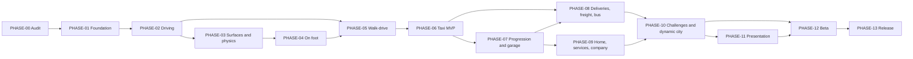

# Roadmap — Drive the City II

| Field | Value |
|---|---|
| ID | DOC-ROADMAP |
| Document status | In review (phase order consolidated from the historical plan and the owner brief of 2026-10-18) |
| Scope | v1.0 delivery sequence; expansions are listed in [EXPANSIONS](docs/product/EXPANSIONS.md) |
| Responsible role | Coordinator (maintainer); project owner approves changes to phase order or gates |
| Related documents | [PRD](docs/product/PRD.md), [Phase documents](docs/planning/phases/README.md), [PROJECT_STATUS](docs/PROJECT_STATUS.md), [TRACEABILITY](docs/planning/TRACEABILITY.md), [RISKS_AND_OPEN_QUESTIONS](docs/planning/RISKS_AND_OPEN_QUESTIONS.md) |
| Last updated | 2026-10-18 |

> **Current position:** pre-development. PHASE-00 is in progress: the read-only audits TASK-0001 and TASK-0002 are
> in review. No runtime work has started, and **PHASE-00 is not completed**.
> The documentation baseline (TASK-0000) does not complete any phase or milestone.

## 1. Authority

This file is the single source of truth for **phase order, phase dependencies, and milestones**. What each phase must
deliver is detailed in its phase document. Requirements are defined in the [PRD](docs/product/PRD.md). The demonstrated
state of the project is tracked only in [PROJECT_STATUS](docs/PROJECT_STATUS.md).

It consolidates the earlier Portuguese planning conversation ([chat.md](chat.md), historical input SRC-006). Where the
two differ, the owner brief of 2026-10-18 wins, and the difference is recorded as a `CONF-*` entry in the
[register](docs/planning/RISKS_AND_OPEN_QUESTIONS.md). No other roadmap is active.

## 2. Strategy

1. **Foundation before content.** First build one small, reliable loop: walk → enter the car → drive → complete a fare
   → park → exit → save → close → reopen and continue. Each new career or system then extends something that already
   works, instead of resting on an unstable prototype.
2. **Evidence-gated phases.** A phase passes only when its acceptance gate is met with recorded evidence
   ([evidence](docs/quality/evidence/README.md)). Compiling is not passing. Documentation is not passing.
3. **Critical contracts first.** Control authority, entity lifecycle, and save safety are settled before content
   multiplies ([SPEC-CONTROL](docs/architecture/CONTROL_AUTHORITY.md), [SPEC-ENTITY](docs/architecture/ENTITY_LIFECYCLE.md),
   [SPEC-SAVE](docs/architecture/SAVE_FORMAT.md)).
4. **CS2 is the only runtime.** Motor Town is a design reference only. Melty is optional. The project works without
   either ([ADR-0001](docs/architecture/decisions/ADR-0001-host-game-and-runtime.md)).
5. **Fun checkpoint.** At M2 the project owner judges whether walking and driving are enjoyable before more content
   is added (RISK-023).

## 3. Milestones

| Milestone | Phases | Expected result | Status |
|---|---|---|---|
| **M0 — Verified foundation** | 00–01 | Safe isolated environment, audited base, reproducible build, and a save foundation that handles invalid data. | Not reached |
| **M1 — Playable walking/driving sandbox** | 02–05 | Building → walk → enter → drive → park → exit → back to building, with reliable control. | Not reached |
| **M2 — Taxi-career MVP** | 06 | A complete, persistent, repeatable taxi career; the fun checkpoint. | Not reached |
| **M3 — Content alpha** | 07–09 | Progression, garage, four careers, home and service points, a basic company. | Not reached |
| **M4 — Refined and validated beta** | 10–12 | Dynamic city, challenges, presentation, accessibility, broad validation. | Not reached |
| **M5 — Distributable v1.0** | 13 | Packaged, documented, license-audited release with a defined maintenance procedure. | Not reached |

### 3.1 Next playable milestone: M1, refined on 2026-10-18

M1 is the first milestone with player-facing gameplay. It is reached at the end of PHASE-05, after the M0 foundation.
It must demonstrate this loop **inside an actual CS2 city** (the lab city), with real player input:

> **Load city → enter on-foot mode → walk → enter a supported vehicle → drive, steer, and brake → stop → exit →
> continue walking → return to city management.**

- **Supported vehicle in M1:** sandbox mode only. That means a native passenger car borrowed and handed back
  (`BorrowedNativeVehicle`), plus one mod-spawned test car if OPEN-012 is resolved by then. There is no career, money,
  or progression; those start at M2.
- **Validation:** M1 is accepted only on recorded evidence for six areas. Each maps to existing tests (details in
  [PHASE-05](docs/planning/phases/PHASE-05-walk-drive-integration.md) §13):
  1. real player-controlled movement;
  2. collision and vehicle interaction;
  3. correct input ownership when changing modes;
  4. the city simulation continuing during the loop;
  5. recovery when an interaction cannot complete;
  6. save and load behavior: saving during the loop yields a loadable city, the player returns in a safe state, and
     nothing borrowed or spawned is left behind.
- **Existing versus to-build:** nothing of the loop exists in this project yet. The candidate base mod covers part of
  "drive, steer, and brake" for borrowed native cars, at source level only, unverified on the installed game.
  On-foot mode, entering and exiting, building collision, the state machine, and save integration must be built (see
  [BASE_MOD_AUDIT](docs/research/BASE_MOD_AUDIT.md) and PHASE-05 §13).
- **Prerequisites:**
  - PHASE-00 gate (TASK-0003 evidence);
  - PHASE-01 foundation (starting with TASK-0004);
  - owner decisions OPEN-027, OPEN-028, and OPEN-029;
  - acceptance of ADR-0005;
  - the ADR-0004 physics decision (PHASE-03);
  - the avatar representation (OPEN-010, PHASE-04).

## 4. Phases

| Phase | Title | Focus | Exit gate (summary) | Depends on | Milestone |
|---|---|---|---|---|---|
| [PHASE-00](docs/planning/phases/PHASE-00-audit-and-windows.md) | Audit and Windows environment | Windows, installed game, and toolchain discovery; candidate source, license, and dependency audit; isolated test setup. | Reproducible base-mod build and runtime baseline recorded with evidence, plus a list of limitations. Documentation alone cannot pass. | — | M0 |
| [PHASE-01](docs/planning/phases/PHASE-01-foundation-and-save-safety.md) | Foundation and save safety | Independent mod identity, module boundaries, diagnostics, activation and unload, save foundation. | Install, open, save, close, reopen, and disable with no unwanted city change; invalid data never overwrites the last valid copy. | 00 | M0 |
| [PHASE-02](docs/planning/phases/PHASE-02-basic-driving.md) | Basic driving | One-car direct driving, input and camera separation, AI handback, lane-state cleanup. | Drive a validation route (curves, junctions, slopes); the handed-back vehicle rejoins native traffic with no stale route or invisible blocker. | 01 | M1 |
| [PHASE-03](docs/planning/phases/PHASE-03-surfaces-collisions-and-physics.md) | Surfaces, collisions, and physics | Surface and collision laboratory, physics comparison, bridges and tunnels, time and focus rules. | No passing through buildings, no level switching on bridges or tunnels, predictable behavior after pause, focus loss, and frame-rate swings; ADR-0004 decided with evidence. | 02 | M1 |
| [PHASE-04](docs/planning/phases/PHASE-04-on-foot-character.md) | On-foot character | Visible controllable avatar, walking and running, cameras, animation, obstacles, recovery. | Complete a representative urban circuit with no clipping, no falling, and no permanent loss of control. | 03 | M1 |
| [PHASE-05](docs/planning/phases/PHASE-05-walk-drive-integration.md) | Walk–drive integration | Enter, drive, park, and exit; safe exit placement; vehicle-removal handling. | Proposed: 50 successful transition cycles across the scenario matrix, with no duplication, camera loss, or traffic blocking. | 02, 04 | M1 |
| [PHASE-06](docs/planning/phases/PHASE-06-taxi-career-mvp.md) | Taxi career MVP | Full taxi loop, with a minimal wallet, ledger, and rental slice. | Proposed: 20 rides in different districts, including a cancellation and a save/load during a mission, with each ride paid exactly once. | 05, 01 | M2 |
| [PHASE-07](docs/planning/phases/PHASE-07-progression-and-garage.md) | Progression and garage | Wallet and progression, rental/ownership/sale, garage, fuel, maintenance, upgrades, financial recovery. | A new profile can rent, work, buy, and maintain a vehicle; every transaction persists; no softlock. | 06 | M3 |
| [PHASE-08](docs/planning/phases/PHASE-08-delivery-freight-and-bus.md) | Deliveries, freight, and bus | Urban delivery, rigid-truck freight, and bus on city lines with career passengers. | Each career has reachable contracts, completion, valid failure paths, reward, and persistence; city edits lead to replanning or safe cancellation. Per-career introductions are specified in SPEC-ONBOARD but do not gate this phase (CONF-013). | 06 (07 for ownership-dependent content) | M3 |
| [PHASE-09](docs/planning/phases/PHASE-09-home-services-and-company.md) | Home, services, and company | Residential base, service points, basic company with managerial fleet simulation. | Progress from independent driver to a small company (second vehicle, one hire) and reload with no financial inconsistency or implied physical fleet. | 07 | M3 |
| [PHASE-10](docs/planning/phases/PHASE-10-challenges-and-dynamic-city.md) | Challenges and dynamic city | Checkpoints, time trials, parking challenges, demand-informed jobs, reaction to city edits. | Editing the city during a career corrupts neither profile nor save and leaves no indefinitely impossible missions; native economy writes stay a gated, off-by-default experiment. | 08, 09 | M4 |
| [PHASE-11](docs/planning/phases/PHASE-11-presentation-and-accessibility.md) | Presentation and accessibility | HUD, map, menus, tutorial, audio, animation, gamepad, accessibility, English/PT-BR localization. | A new player completes their first work without console or developer help. | 07–10 (UI work may start earlier; see §5) | M4 |
| [PHASE-12](docs/planning/phases/PHASE-12-beta-and-validation.md) | Beta and validation | Representative cities, hardware, DLCs, and supported mods. | Proposed: 30 save/load cycles and sessions of at least two hours; no known critical save corruption, duplicated rewards, permanent loss of control, or uncompletable mandatory content. | 10, 11 | M4 |
| [PHASE-13](docs/planning/phases/PHASE-13-release-and-maintenance.md) | Release and maintenance | Release review, package and license audit, tested install/update/clean exit, compatibility declaration, maintenance procedure. | An independent tester installs the mod on a supported configuration and completes the intended experience. | 12 | M5 |

The quantities above (50 cycles, 20 rides, 30 save/load cycles, two-hour sessions) are **proposed acceptance criteria**,
not results or effort estimates. A recurring frame-time regression above 10% is an initial **investigation trigger**,
not a performance budget. There are no promised dates or frame rates.

## 5. Dependency graph and parallel work

Parallel work rules:

- **Allowed early, behind stable contracts:**
  - pure career logic (mission lifecycle, ledger, economy rules), which is testable without CS2;
  - UI layout prototypes;
  - localization string externalization;
  - test definitions.
- **Never earlier than its phase:** anything that integrates with the game world (control, entities, cameras, surfaces,
  persistence hooks). This waits until control authority and persistence are stable (end of PHASE-01 for persistence,
  end of PHASE-02/03 for control).
- **Never concurrent without coordination:** changes to control authority, the entity lifecycle, or the save format
  ([AGENTS.md](AGENTS.md)).

## 6. Gate policy

1. The phase document lists its acceptance gate and tests.
2. QA records evidence runs (`RUN-NNNN`) following [TEST_STRATEGY](docs/quality/TEST_STRATEGY.md).
3. A Reviewer who did not implement the change checks the evidence against the gate.
4. The project owner accepts or rejects the gate. Only then do the phase status and [PROJECT_STATUS](docs/PROJECT_STATUS.md)
   change.
5. A failed gate keeps the phase open. The recovery steps in the phase document apply. If a requirement proves
   infeasible, a scope review is recorded; the requirement is not dropped silently.

## 7. First concrete goal

Complete PHASE-00 and PHASE-01 (M0). Then pursue the integrated demonstration (end of M2):

> Walk → enter the car → drive → complete a fare → park → exit → save → close the game → reopen and continue.

The next authorized work is listed in [PROJECT_STATUS](docs/PROJECT_STATUS.md) and
[HANDOFF_TO_PHASE_00](docs/agents/HANDOFF_TO_PHASE_00.md). TASK-0001 and TASK-0002 (the read-only audits) were
executed on 2026-10-18. Next is [TASK-0003](docs/planning/tasks/TASK-0003-isolated-baseline-validation.md) (the runtime
baseline, which needs owner authorization), then [TASK-0004](docs/planning/tasks/TASK-0004-native-mod-skeleton.md).

## 8. After v1.0

The following are post-1.0 expansions and are not part of this roadmap's gates:

- **Urban services:** native passengers, towing, ambulance, fire, and police missions.
- **Immersion:** interiors, a dealership, vehicle-specific cockpits, steering wheels.
- **Advanced logistics:** articulated trucks, physical cargo, physical employee fleets, municipal-economy integration.
- **Larger systems:** part-by-part maintenance, structural damage, multiplayer.

See [EXPANSIONS](docs/product/EXPANSIONS.md).
