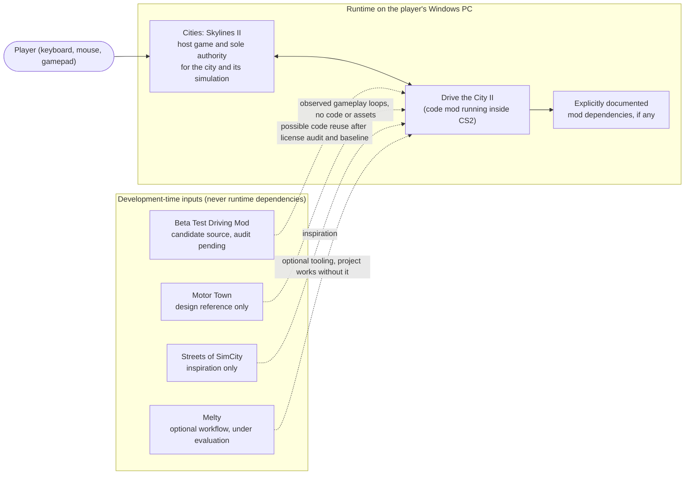
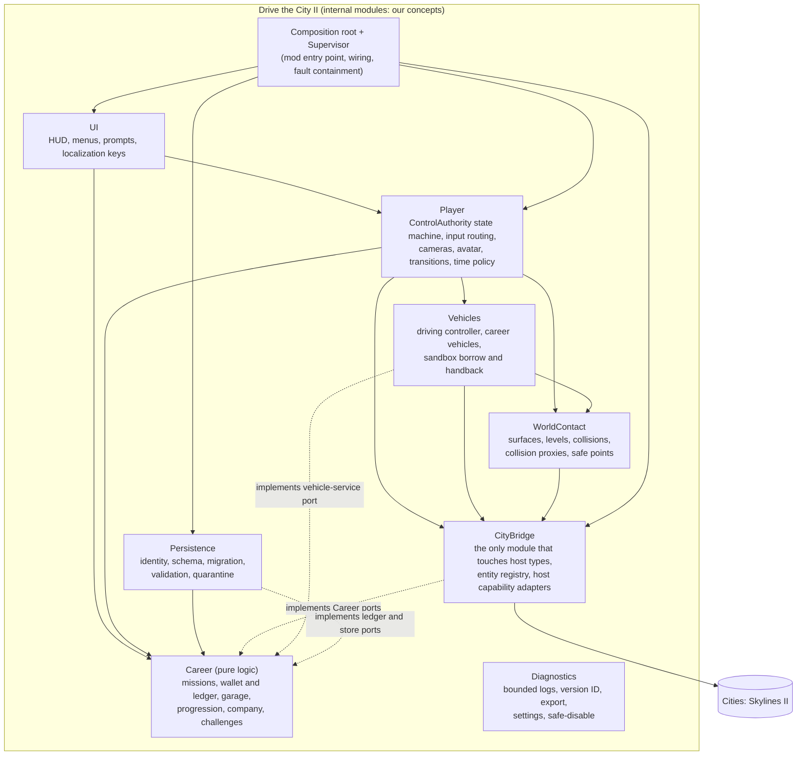

# Architecture Overview

| Field | Value |
|---|---|
| ID | SPEC-ARCH |
| Document status | Draft |
| Release scope | v1.0 |
| Phases | PHASE-01 (module boundaries), then every phase that adds a module or port |
| Responsible role | Coordinator (maintainer); Reviewer checks every change to module boundaries or dependency direction |
| Related requirements | REQ-CTRL-001, REQ-ENTITY-003, REQ-CITY-001, REQ-SAVE-001, REQ-RECOV-002, REQ-DIAG-001, REQ-REL-004 |
| Related documents | [SPEC-MODULES](MODULE_CONTRACTS.md), [SPEC-CONTROL](CONTROL_AUTHORITY.md), [SPEC-ENTITY](ENTITY_LIFECYCLE.md), [SPEC-SAVE](SAVE_FORMAT.md), [ADR index](decisions/README.md), [PRD](../product/PRD.md), [ROADMAP](../../ROADMAP.md) |
| Last updated | 2026-10-18 |

> **Status:** this is a proposed architecture for a mod that does not exist yet. Nothing here has been built or run.
> Validation status of every contract below: **Not run**. Module names (CityBridge, Player, WorldContact, Vehicles,
> Career, Persistence, UI, Diagnostics) are **our internal design concepts**, not Cities: Skylines II APIs.

## 1. Purpose

This document gives the system-level picture of Drive the City II: where the mod sits relative to the host game,
which internal modules exist, which way dependencies point, and how one pass through the core loop moves through
those modules. Detailed contracts live in the specifications listed in section 9; this file is the map, not the
territory.

## 2. Scope and non-goals

In scope: system context, module overview, dependency direction, runtime walkthrough of the core loop, architectural
principles, ADR mapping, and the list of host capabilities that are still unknown.

Not in scope:

- Gameplay rules (missions, prices, progression). See the gameplay specifications, for example
  [SPEC-MISSION](../gameplay/MISSION_FRAMEWORK.md) and [SPEC-ECON](../gameplay/PROGRESSION_AND_ECONOMY.md).
- Build configuration, target framework, toolchain versions. See [TOOLCHAIN_MATRIX](../engineering/TOOLCHAIN_MATRIX.md)
  (OPEN-002, OPEN-003).
- Any statement that the host exposes a particular system, component, hook, or symbol. Host capabilities are named
  abstractly in section 8 and each one points to the open question that will verify it.

## 3. System context

- **Cities: Skylines II (CS2)** is the world. It owns the city, the native simulation (citizens, traffic, economy,
  services), rendering, the game camera in Building mode, and its own save files **[Owner requirement]**
  ([ADR-0001](decisions/ADR-0001-host-game-and-runtime.md)).
- **The mod** runs inside CS2 as a code mod. It adds a player character, direct vehicle control, and a career layer.
  It does not export the city to another engine and does not run a second synchronized city simulation.
- **Motor Town** and **Streets of SimCity** shape design only ([MOTOR_TOWN_REFERENCE](../research/MOTOR_TOWN_REFERENCE.md)).
  **Melty** is an optional workflow aid being evaluated ([MELTY_EVALUATION](../research/MELTY_EVALUATION.md)). None of
  them is a runtime dependency (REQ-REL-004).
- **Beta Test Driving Mod** is a candidate source for direct vehicle control. Reuse depends on
  [BASE_MOD_AUDIT](../research/BASE_MOD_AUDIT.md) and the isolated baseline (OPEN-004, OPEN-005). The architecture does
  not depend on it: the Vehicles module must be implementable either by adapting that code or independently.

## 4. Module overview

Diagnostics is used by every module through a logging port and is omitted from the arrows for readability.

| Module | One-line responsibility | Writes (owner of) |
|---|---|---|
| Composition root + Supervisor | Creates modules, wires adapters to ports, registers updates, contains faults, orders shutdown. | Module lifecycle, fault state. |
| CityBridge | Translates between host-game data and our types; owns the entity registry. | Host entity spawn/despawn requests; registry records. |
| Player | Owns the player state, movement-authority grants, camera owner, input routing, avatar motion, sim-speed policy. | Player state; avatar pose; camera; recorded/restored simulation speed. |
| WorldContact | Answers "where is valid ground and what blocks me"; manages bounded collision proxies; finds safe points. | Collision proxies only. |
| Vehicles | Drives the controlled vehicle; spawns, parks, stows career vehicles; borrows and hands back native vehicles in sandbox mode. | Controlled-vehicle pose; career vehicle entities; handback cleanup. |
| Career | Pure rules: mission lifecycle, settlement, ledger, wallet, garage records, progression, company, challenges. | In-memory career state only. |
| Persistence | Turns career state into versioned, identity-bound records and back; quarantines invalid data. | Persisted career data. |
| UI | Presents state and sends commands; never writes state directly. | Nothing outside its own view state. |
| Diagnostics | Logging, version identification, sanitized export, settings, safe-disable switch. | Log files, settings, export bundles. |

Full contracts, ports, and forbidden dependencies: [SPEC-MODULES](MODULE_CONTRACTS.md).

## 5. Dependency direction

1. **Inward toward pure logic.** Career depends on nothing else in the mod and on no host or engine type. It declares
   ports (interfaces) that other modules implement. This is what makes it testable without CS2.
2. **Host access through one door.** Only CityBridge references host-game types. Player, Vehicles, WorldContact, and
   Persistence reach the host only through CityBridge capability adapters. When a game update breaks an integration,
   the damage is confined to CityBridge (mitigation for RISK-007).
3. **No upward calls.** CityBridge never calls Player, Career, or UI logic; it raises events that the composition root
   routes. WorldContact never decides player state; it answers queries.
4. **UI is a client.** UI reads view models and sends commands to Player or Career. It never writes entities, career
   records, or persisted data.
5. **Persistence owns the bytes.** No other module writes persisted career data or chooses a storage location.

A dependency that violates these rules is a defect even if it compiles. RISK-104 (new) tracks erosion of the
pure-logic boundary.

## 6. Runtime walkthrough of the core loop

The owner's core loop ([PRD](../product/PRD.md) section 4) traced through the modules. Each step lists the state from
[SPEC-CONTROL](CONTROL_AUTHORITY.md) and the specification that holds the detailed contract. Everything is
**[Proposal]**.

| # | Step | State | What happens (modules) | Detailed in |
|---|---|---|---|---|
| 1 | City building | `Building` | Host owns camera, input, and speed. CityBridge listens for host lifecycle events. No mod entity exists in the world. | [SPEC-CONTROL](CONTROL_AUTHORITY.md) |
| 2 | Enter character mode | `Building` → `OnFoot` | Player checks guards; TimePolicy records the prior speed; CityBridge and Career revalidate home base, stowed vehicles, and active missions after any edits; WorldContact finds a spawn point; CityBridge spawns and registers the Avatar; Player takes the camera and switches the input context; normal speed is set. | [SPEC-CONTROL](CONTROL_AUTHORITY.md), [SPEC-CITY](CITY_INTEGRATION.md), [SPEC-TIME](GAME_TIME_AND_PAUSE.md) |
| 3 | Walk | `OnFoot` | Player's avatar controller turns input into intended motion; WorldContact clamps it to valid ground and blocks it at facades and proxies; motion per frame is bounded. | [SPEC-PLAYER](../gameplay/PLAYER_AND_CAMERAS.md), [SPEC-CONTACT](WORLD_CONTACT.md) |
| 4 | Rent and accept work | `OnFoot` | UI sends commands to Career at a service point. Career validates the offer through the city-query and route-planner ports, records the rental in the ledger with a unique TransactionId, and asks the vehicle-service port (Vehicles) to spawn a Rental CareerVehicle at a validated access point. | [SPEC-MISSION](../gameplay/MISSION_FRAMEWORK.md), [SPEC-GARAGE](../gameplay/VEHICLE_OWNERSHIP_AND_GARAGE.md), [SPEC-ENTITY](ENTITY_LIFECYCLE.md) |
| 5 | Enter the vehicle | `OnFoot` → `EnteringVehicle` → `Driving` | Proximity selection; guards (stationary, career vehicle with access right); Vehicles holds the vehicle; Player runs the transition; then the driving controller receives movement authority and the camera switches to the chase rig. | [SPEC-TRANSITION](../gameplay/WALK_DRIVE_TRANSITIONS.md), [SPEC-CONTROL](CONTROL_AUTHORITY.md) |
| 6 | Drive the mission | `Driving` | Vehicles writes the vehicle pose (sole authority); WorldContact supplies surface and collision answers; Career advances legs from arrival observations; career passengers are MissionObjects spawned through CityBridge. | [SPEC-DRIVING](../gameplay/VEHICLE_DRIVING.md), [SPEC-TAXI](../gameplay/careers/TAXI.md) |
| 7 | Complete and get paid | `Driving` | Career reaches a terminal outcome and settles once; the ledger rejects any duplicate TransactionId; XP and reputation update; UI shows the result. | [SPEC-ECON](../gameplay/PROGRESSION_AND_ECONOMY.md) |
| 8 | Park and exit | `Driving` → `ExitingVehicle` → `OnFoot` | Guards (stationary; WorldContact finds a safe exit point, with alternates); the avatar is placed; the vehicle is registered as Parked. | [SPEC-TRANSITION](../gameplay/WALK_DRIVE_TRANSITIONS.md) |
| 9 | Return to building | `OnFoot` → `Building` | Avatar despawned; career vehicles stowed as records; mission objects removed; camera, input, and prior speed restored. | [SPEC-CONTROL](CONTROL_AUTHORITY.md), [SPEC-ENTITY](ENTITY_LIFECYCLE.md) |
| 10 | Save | any (host save event) | Persistence takes a consistent snapshot from Career (stable references only), validates it, and writes it bound to a new save revision ID. Invalid data never replaces the last valid copy. | [SPEC-SAVE](SAVE_FORMAT.md) |
| 11 | Close and reopen | `Loading` overlay → `Building` | Persistence identifies the save, checks the schema version, migrates, validates, and revalidates references through CityBridge, or falls back safely. The player resumes in `Building`. | [SPEC-SAVE](SAVE_FORMAT.md), [SPEC-RECOVERY](ERROR_RECOVERY.md) |

Failure branches (blocked exit, vehicle removed mid-transition, invalid ground, unreachable destination, corrupt
data) are specified in [SPEC-RECOVERY](ERROR_RECOVERY.md) and the specifications linked above.

## 7. Architectural principles

| ID | Principle | Consequence |
|---|---|---|
| AP-01 | **The host is the authority for the world.** | The mod reads city data before it writes anything; v1.0 writes no native economic or service state (REQ-CITY-001). |
| AP-02 | **One movement authority, one camera owner.** | Every controlled entity has exactly one writer; transitions hand authority over explicitly (ADR-0002). |
| AP-03 | **Pure core, thin adapters.** | Career rules run without CS2; host specifics stay in CityBridge (RISK-007, RISK-104). |
| AP-04 | **Records, not entities, are persistent.** | Persisted data holds stable IDs and descriptors; mod entities are respawned from records after load and never trusted across a reload (REQ-SAVE-003). |
| AP-05 | **Fail safe toward Building.** | Any contained fault can always fall back to `Building` with entities cleaned up and the career untouched (REQ-RECOV-002). |
| AP-06 | **Everything is bounded.** | Logs, proxies, retries, transition timeouts, per-frame motion, and revalidation work have explicit limits. |
| AP-07 | **Money moves exactly once.** | Deterministic TransactionIds and an append-only ledger make settlement idempotent across reloads (REQ-CAREER-004). |
| AP-08 | **Capabilities are verified, not assumed.** | Every host capability sits behind a port, and each port has an open question until evidence exists (section 8). |
| AP-09 | **Honest presentation.** | Managerial company simulation, placeholders, and experiments are labeled as such (REQ-COMPANY-002, REQ-ART-002). |

## 8. Known unknowns: host capabilities the design needs

Each capability is described abstractly. The adapter that would provide it lives in CityBridge. Until the linked
question is answered with evidence, the capability is **[Unverified]**.

| Capability needed | Used by | Open question |
|---|---|---|
| A mod entry point with load and unload notifications | Composition root | OPEN-002, OPEN-003 |
| Per-frame update registration and ordering relative to native movement and camera | Player, Vehicles | OPEN-107 |
| Notifications for load, save, autosave, quit to menu, and mod disable | Persistence, Player | OPEN-101 |
| Reading and setting simulation speed; detecting pause | Player (TimePolicy) | OPEN-013 |
| Detecting window focus loss and host menus | Player | OPEN-102 |
| Capturing character input without triggering building tools; remapping; gamepad | Player | OPEN-014, OPEN-025 |
| Taking over and restoring the active camera | Player | OPEN-111 |
| Taking over and handing back a native vehicle cleanly | Vehicles | OPEN-011 |
| Spawning and removing career vehicles and mission objects, and counting them | Vehicles, CityBridge | OPEN-012, OPEN-034 |
| A visible avatar representation with animation | Player | OPEN-010 |
| Surface height, normal, type, and level queries | WorldContact | OPEN-007 |
| Building and static-obstacle collision data | WorldContact | OPEN-008 |
| Road connectivity and route queries | Career (via port) | OPEN-019 |
| Building access candidates (curbs, bays, stops) | Career (via port) | OPEN-018 |
| Transit lines and ordered stops | Career (via port) | OPEN-020 |
| Detecting city edits | CityBridge | OPEN-021 |
| Stable references to native objects across save/load | Persistence, CityBridge | OPEN-103 |
| Detecting deletion of a referenced entity | CityBridge | OPEN-106 |
| Custom data storage and save identity | Persistence | OPEN-006, OPEN-022, OPEN-108 |
| Behavior of the host when mod code throws | Supervisor | OPEN-105 |
| UI technology and localization mechanism | UI | OPEN-015, OPEN-026 |

A capability that turns out to be unavailable triggers a scope review ([DOCUMENTATION_RULES](../DOCUMENTATION_RULES.md)
section 8), not a silent change to a requirement.

## 9. Specifications and decisions

| Concern | Specification | Decision record |
|---|---|---|
| Host game and runtime | This document | [ADR-0001](decisions/ADR-0001-host-game-and-runtime.md) (Proposed) |
| Module contracts and testability | [SPEC-MODULES](MODULE_CONTRACTS.md) | ADR-0001 |
| Player states, authority, cameras, input | [SPEC-CONTROL](CONTROL_AUTHORITY.md) (critical area) | [ADR-0002](decisions/ADR-0002-control-authority.md) (Proposed) |
| Entity categories, registry, handback | [SPEC-ENTITY](ENTITY_LIFECYCLE.md) (critical area) | ADR-0002 |
| Clocks, pause, speed, bounded motion | [SPEC-TIME](GAME_TIME_AND_PAUSE.md) | ADR-0004 (motion stepping) |
| Surfaces, collisions, proxies | [SPEC-CONTACT](WORLD_CONTACT.md) | [ADR-0004](decisions/ADR-0004-physics-strategy.md) (Proposed; pending PHASE-03) |
| Read/write boundary with the city | [SPEC-CITY](CITY_INTEGRATION.md) | ADR-0003 (economic separation) |
| Save identity, storage, migration | [SPEC-SAVE](SAVE_FORMAT.md) (critical area) | [ADR-0003](decisions/ADR-0003-career-save-isolation.md) (Proposed; storage pending OPEN-006) |
| Fault containment and recovery | [SPEC-RECOVERY](ERROR_RECOVERY.md) | — |
| Performance measurement and budgets | [SPEC-PERF](PERFORMANCE_BUDGET.md) | — |

## 10. Failure handling (system level)

- The Supervisor wraps every module update. A fault is classified ([SPEC-RECOVERY](ERROR_RECOVERY.md)), logged with the
  mod version, and contained: the affected feature degrades, and if control is affected the player is returned to
  `Building` with cleanup.
- If Persistence or Career invariants fail, persisted data is write-protected for the session: the last valid copy
  stays untouched and the invalid snapshot is quarantined.
- If CityBridge detects that a required capability is missing (for example after a game update), the dependent
  feature is disabled with a clear message; the city remains playable in `Building`.

## 11. Acceptance criteria

| Criterion | Evidence | Validation |
|---|---|---|
| Career logic builds and runs its tests with no host-game reference. | Logic test run (TEST-CAREER-004 and others in [TEST_SCENARIOS](../quality/TEST_SCENARIOS.md)) | Not run |
| Only CityBridge references host types (dependency check during review). | Review record in PHASE-01 | Not run |
| The core loop of section 6 completes and survives save, close, and reopen. | TEST-TAXI-001, TEST-SAVE-001, TEST-SAVE-005 | Not run |
| A forced fault in any module returns the player to `Building` without save damage. | TEST-RECOV-002 | Not run |
| The mod runs without Motor Town or Melty installed or running. | TEST-REL-004 | Not run |

## 12. Open questions and risks

Central entries: OPEN-002, OPEN-003, OPEN-006, OPEN-007, OPEN-008, OPEN-011, OPEN-012, OPEN-013, OPEN-014,
OPEN-018 to OPEN-021, RISK-004, RISK-005, RISK-007, RISK-014. New entries raised by the architecture group:

- OPEN-101 — which host lifecycle events (load, save, autosave, quit, mod disable) the mod can observe.
- OPEN-102 — detecting window focus loss and host menus.
- OPEN-103 — stable references to native city objects across save/load.
- OPEN-105 — host behavior when mod code throws, and where faults can be contained.
- OPEN-106 — detecting deletion or replacement of a referenced entity.
- OPEN-107 — update timing and ordering relative to native movement and camera.
- OPEN-111 — taking over and restoring the active camera.
- RISK-104 — host types leaking into pure career logic.

All are recorded in [RISKS_AND_OPEN_QUESTIONS](../planning/RISKS_AND_OPEN_QUESTIONS.md).

## 13. Provenance notes

- System roles of CS2, Motor Town, Melty, and the base mod: **[Owner requirement]** (owner brief of 2026-10-18).
- The module split (city integration, character, vehicles, missions, economy, persistence, interface) first appeared
  in the earlier planning conversation **[Historical input]** ([chat.md](../../chat.md)); the owner brief named the eight
  modules used here.
- External facts about the base mod and the official toolchain are recorded with their provenance in
  [SOURCES](../research/SOURCES.md); this document relies on none of them as proof.
