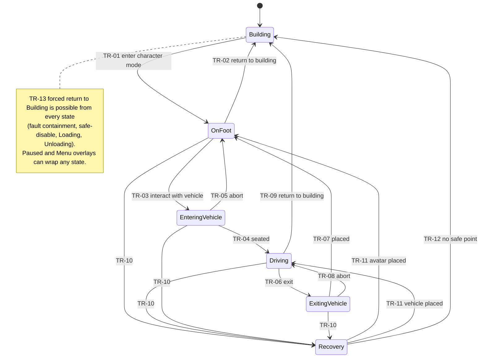

# Control Authority

| Field | Value |
|---|---|
| ID | SPEC-CONTROL |
| Document status | Draft |
| Release scope | v1.0 |
| Phases | PHASE-01 (state skeleton, overlays), PHASE-02 (Driving, input and camera separation), PHASE-03 (pause and focus), PHASE-04 (OnFoot, Recovery), PHASE-05 (transitions) |
| Responsible role | Coordinator (maintainer); **critical area**: Reviewer sign-off required for every change; no uncoordinated concurrent edits |
| Related requirements | REQ-CTRL-001, REQ-CTRL-002, REQ-CTRL-003, REQ-CTRL-004, REQ-TRANS-001 to REQ-TRANS-004, REQ-ENTITY-002, REQ-TIME-001, REQ-TIME-002, REQ-RECOV-001, REQ-RECOV-002 |
| Related documents | [ADR-0002](decisions/ADR-0002-control-authority.md), [SPEC-ENTITY](ENTITY_LIFECYCLE.md), [SPEC-TIME](GAME_TIME_AND_PAUSE.md), [SPEC-TRANSITION](../gameplay/WALK_DRIVE_TRANSITIONS.md), [SPEC-PLAYER](../gameplay/PLAYER_AND_CAMERAS.md), [SPEC-INPUT](../experience/CONTROLS_AND_ACCESSIBILITY.md), [SPEC-RECOVERY](ERROR_RECOVERY.md) |
| Last updated | 2026-10-18 |

> Required invariants are **[Owner requirement]** where they restate REQ-CTRL-*; the state machine, numbers, and
> mechanisms are **[Proposal]**. No host-game hook is assumed; host capabilities are referenced by open question.
> Validation status of everything here: **Not run**.

## 1. Purpose

Guarantee that, at every moment, exactly one system moves each controlled entity, exactly one system drives the
camera, and input reaches only the system that should receive it. This spec owns the player state machine
(implemented in the Player module, [SPEC-MODULES](MODULE_CONTRACTS.md)), its overlays, transitions, guards, and the
cleanup that makes every exit safe.

## 2. Scope and non-goals

In scope: the six player states and four overlays, movement authority and camera ownership per state, input routing,
transition guards and side effects, cleanup, invariants, native-AI handback triggers, failure handling, sandbox
versus career differences.

Not in scope: how transitions look and feel (animation, prompts, exit-point preference), which is
[SPEC-TRANSITION](../gameplay/WALK_DRIVE_TRANSITIONS.md); vehicle handling, which is
[SPEC-DRIVING](../gameplay/VEHICLE_DRIVING.md); the handback protocol steps, which are in
[SPEC-ENTITY](ENTITY_LIFECYCLE.md).

## 3. Concepts

- **Movement authority:** a grant, held by one controller, to write one entity's pose and velocity. Grants are
  issued and revoked only by the ControlAuthority state machine. A controller writes only while it holds a grant.
- **Camera owner:** the single system that drives the active camera: the host building camera, or one of the
  Player camera rigs (first-person, third-person, chase, transition, recovery).
- **Input context:** the set of actions currently delivered. Exactly one context is active.
- **Stable states:** `Building`, `OnFoot`, `Driving`. **Transitional states:** `EnteringVehicle`, `ExitingVehicle`,
  `Recovery`; each has a bounded timeout.
- **Overlays:** `Paused` and `Menu` suspend the current state without replacing it. `Loading` and `Unloading` wrap a
  mandatory teardown that always ends in `Building` (or termination); they never resume the underlying state.

## 4. States

| State | Meaning | Mod entities live in the world | Exit paths |
|---|---|---|---|
| `Building` | Normal CS2 city building. The mod is passive. | None (career vehicles stowed, no avatar, no mission objects) | `OnFoot` |
| `OnFoot` | Player controls the Avatar. | Avatar; parked career vehicles nearby; mission objects in range | `EnteringVehicle`, `Building`, `Recovery` |
| `EnteringVehicle` | Avatar moves to the seat of a stationary, available vehicle. | Avatar, target vehicle | `Driving`, `OnFoot` (abort), `Recovery` |
| `Driving` | Player controls a vehicle; the avatar is attached and has no authority. | Vehicle, attached avatar, mission objects | `ExitingVehicle`, `Building`, `Recovery` |
| `ExitingVehicle` | Avatar leaves a stationary vehicle for a validated exit point. | Avatar, vehicle | `OnFoot`, `Driving` (abort), `Recovery` |
| `Recovery` | Mod moves the avatar or vehicle to a validated safe point. | As before entry | `OnFoot`, `Driving`, `Building` (fallback) |

## 5. Authority, camera, and input per state

| State | Avatar authority | Vehicle authority | Camera owner | Input context |
|---|---|---|---|---|
| `Building` | — (no avatar) | Native AI for native vehicles; no career vehicle in world | Host building camera | Host (building tools, building camera) |
| `OnFoot` | Player avatar controller | Parked career vehicles: Vehicles (hold only) | Player on-foot rig (first- or third-person) | Character.OnFoot |
| `EnteringVehicle` | Player transition controller | Vehicles (stationary hold); sandbox: borrowed after takeover | Player transition rig | Transition (cancel, pause, menu) |
| `Driving` | None (attached to seat) | Vehicles driving controller | Player chase or hood rig | Character.Driving |
| `ExitingVehicle` | Player transition controller | Vehicles (stationary hold, parking brake) | Player transition rig | Transition |
| `Recovery` | Player recovery controller (if avatar) | Player recovery controller via Vehicles (if vehicle) | Player recovery rig (hold or fade) | Recovery (confirm, menu) |
| `Paused` overlay | Retained, writes suspended | Retained, writes suspended | Retained, static | Pause context (unpause, menu); held inputs cleared |
| `Menu` overlay | Retained; writes suspended if the menu pauses | Same | Retained | UI |
| `Loading` / `Unloading` | Revoked during teardown | Revoked; borrowed vehicle handed back if the world is still alive | Returned to host | None |

### 5.1 Input routing rules (REQ-CTRL-003)

- **IR-01** In any Character context, actions that would operate building tools, the building camera, or city
  selection are not delivered to the host. **IR-02** In the Host context, no mod movement action is delivered to the
  avatar or a vehicle. **IR-03** Always available: pause, open menu, and (in stable states) return to `Building` and
  request Recovery. **IR-04** Context switches clear all held inputs, so nothing "sticks" across states.
  **IR-05** Bindings are remappable (REQ-INPUT-001) and must not collide silently with host bindings.
- How suppression is achieved is unknown (OPEN-014). Official documentation states that the host's input system
  disables conflicting mod bindings **[Documented upstream]** ([SOURCES](../research/SOURCES.md)); this must be verified
  in PHASE-02 together with gamepad support (OPEN-025).

## 6. Transitions

Every multi-step transition runs as an ordered list of steps, each with a compensating action. If a step fails, the
compensations run in reverse order and the machine returns to the source state (or `Recovery` if the source state
cannot be restored). Guards are evaluated immediately before the first step and re-checked before the commit step.
Numbers are **[Proposal]** starting values for PHASE-05 tuning.

| ID | From → To | Trigger | Guards | Side effects (in order) | On guard failure |
|---|---|---|---|---|---|
| TR-01 | `Building` → `OnFoot` | Player command | No `Loading`/`Unloading`; safe-disable off; career state available (loaded and validated, or newly created by the player), or sandbox mode; no conflicting controller loaded (REQ-COMPAT-001); spawn point found by WorldContact (home base access point, else nearest walkable point to the camera focus) | 1 record prior simulation speed; 2 revalidate after edits ([SPEC-CITY](CITY_INTEGRATION.md)); 3 spawn and register Avatar; 4 grant avatar authority; 5 take camera; 6 switch input context; 7 set normal speed (OPEN-013); 8 show HUD | Stay in `Building`; message with reason and next step (REQ-UI-003) |
| TR-02 | `OnFoot` → `Building` | Player command, safe-disable, or forced | None that can block (REQ-CTRL-004) | 1 revoke avatar authority; 2 despawn Avatar; 3 suspend active missions and remove mission objects; 4 stow career vehicles as records; 5 return camera to host; 6 switch input to Host; 7 restore recorded speed; 8 hide HUD | — |
| TR-03 | `OnFoot` → `EnteringVehicle` | Interact on the selected vehicle | Vehicle registered and valid; within interaction range (3 m from an entry point); speed below the stationary threshold (0.3 m/s); **career mode:** a CareerVehicle with a current access right (active rental, owned, or assigned service vehicle); **sandbox:** a native vehicle of a borrowable class; no overlay | 1 Vehicles acquires or confirms authority (sandbox: takeover protocol, [SPEC-ENTITY](ENTITY_LIFECYCLE.md)); 2 hold stationary; 3 avatar authority → transition controller; 4 transition camera; 5 Transition input; 6 start timeout (5 s) | Stay `OnFoot`; prompt explains why (too far, moving, not yours) |
| TR-04 | `EnteringVehicle` → `Driving` | Avatar seated | Vehicle still valid; Vehicles holds authority | 1 attach avatar (no authority); 2 grant vehicle authority to driving controller; 3 chase camera; 4 Driving input; 5 Career observes `Boarded` | Treated as TR-05 |
| TR-05 | `EnteringVehicle` → `OnFoot` | Cancel, timeout, or vehicle invalidated | Avatar's pre-entry position still valid (else `Recovery`) | 1 avatar back to pre-entry position; 2 sandbox: hand back immediately; 3 on-foot camera and input | `Recovery` |
| TR-06 | `Driving` → `ExitingVehicle` | Exit command | Speed below stationary threshold; WorldContact found an exit point (preferred curb side, then alternates); no overlay | 1 parking brake; 2 avatar authority → transition controller; 3 transition camera; 4 Transition input; 5 timeout (5 s) | Stay `Driving`; "exit blocked" feedback with a next step (move, or request Recovery) (REQ-TRANS-002) |
| TR-07 | `ExitingVehicle` → `OnFoot` | Avatar placed | Exit point still valid at commit | 1 avatar authority → avatar controller; 2 career vehicle → Parked (Vehicles keeps a hold-only grant); sandbox vehicle → handback starts; 3 on-foot camera and input | Choose next alternate; none left → `Recovery` |
| TR-08 | `ExitingVehicle` → `Driving` | Exit point lost before the avatar detached | Vehicle valid | Revert steps; message | `Recovery` |
| TR-09 | `Driving` → `Building` | Player command, safe-disable, or forced | Player command: speed below stationary threshold. Forced: none | 1 revoke vehicle authority; 2 career vehicle stowed; sandbox vehicle handed back; 3 then as TR-02 steps 2–8 | Player command while moving: prompt to stop |
| TR-10 | any non-`Building` → `Recovery` | Player request (stable states), stuck detector, invalid ground, out of bounds, authority conflict, transition failure without fallback | None | 1 suspend movement writes; 2 Recovery input; 3 recovery camera; 4 safe-point search ([SPEC-RECOVERY](ERROR_RECOVERY.md)) | — |
| TR-11 | `Recovery` → `OnFoot` or `Driving` | Placement validated | Safe point valid at commit | Place entity; re-grant authority to the stable controller; restore camera and input | Next candidate |
| TR-12 | `Recovery` → `Building` | No safe point after 3 searches, or Recovery re-entered 3 times within 60 s | None | Forced TR-02 or TR-09 steps; message; log | — |
| TR-13 | any → `Building` | Critical fault, safe-disable, conflict detected, `Loading`, `Unloading` | None | Run the cleanup of section 7 for every resource the current state holds; restore host camera, input, and speed (speed not restored when a new city is loading) | — |

## 7. Cleanup on every exit

Each state registers the resources it acquires; leaving the state by any path (normal, abort, forced, exception)
releases them in reverse acquisition order. A cleanup step that fails is logged and skipped; the remaining steps
still run.

| Resource | Release action |
|---|---|
| Avatar authority grant | Revoke; controller stops writing in the same frame |
| Vehicle authority grant | Revoke; career vehicle → hold or stow; borrowed vehicle → handback |
| Camera ownership | Restore the previous owner's saved camera state |
| Input context | Clear held inputs; restore previous context |
| Transition timer | Cancel |
| Spawned Avatar | Despawn through the registry |
| Mission object presentations | Remove; mission records remain in Career |
| Simulation speed override | Restore recorded value exactly once |

## 8. Invariants

| ID | Invariant | Checked by |
|---|---|---|
| INV-CTRL-01 | Exactly one player state is active at any time. | Assertion on every transition; TEST-CTRL-002 |
| INV-CTRL-02 | Each controlled entity has at most one movement-authority holder. | Grant table check per frame; TEST-CTRL-001 |
| INV-CTRL-03 | A vehicle under player authority is never moved by native AI in the same frame, and native AI resumes only after handback. | Write-verify check (section 10); TEST-CTRL-001 |
| INV-CTRL-04 | Exactly one camera owner; in `Building` it is the host camera. | Per-frame owner check; TEST-CTRL-002 |
| INV-CTRL-05 | Character input never reaches building tools; building input never moves the avatar or a vehicle. | TEST-CTRL-003 |
| INV-CTRL-06 | Every state exit runs its cleanup, including fault paths. | Fault-injection tests; TEST-RECOV-002 |
| INV-CTRL-07 | After `Loading` or `Unloading`, no avatar, mission object, collision proxy, or borrowed vehicle remains. | Registry census; TEST-ENTITY-003 |
| INV-CTRL-08 | Transitional states are never persisted; a save during them persists the last stable state. | TEST-SAVE-005 |
| INV-CTRL-09 | The recorded simulation speed is restored exactly once per character-mode session. | TEST-CTRL-004, TEST-TIME-001 |
| INV-CTRL-10 | In career mode, only CareerVehicles with an access right can be entered. | TEST-ENTITY-002 |
| INV-CTRL-11 | Recovery and exit place entities only at points validated in the same frame. | TEST-TRANS-002, TEST-RECOV-001 |
| INV-CTRL-12 | No movement writes happen while `Paused`, except cleanup. | TEST-TIME-002 |
| INV-CTRL-13 | Every transitional state ends within its timeout. | TEST-TRANS-003 |
| INV-CTRL-14 | Return to `Building` from `OnFoot` or `Driving` is always possible (player command or forced). | TEST-CTRL-004 |

## 9. When native AI must regain a vehicle

Only a **BorrowedNativeVehicle** (sandbox mode) is ever returned to native AI. Career vehicles are never driven by
native AI in v1.0; they are parked or stowed. Handback is triggered by: TR-05 abort in sandbox; TR-07 exit; TR-09
return to `Building`; TR-13 forced teardown while the world is alive; Recovery failure for a borrowed vehicle. The
protocol (stop, release authority, clear presence and blocking state, rebuild navigation, verify rejoin) is defined in
[SPEC-ENTITY](ENTITY_LIFECYCLE.md) and depends on OPEN-011.

A host save may occur while a native vehicle is borrowed. Whether the mod can observe save events in time is unknown
(OPEN-101). Until it is answered, sandbox driving must keep the borrowed vehicle's native state as close to
"handback-ready" as possible at every frame boundary, and PHASE-02 must test saving while borrowed.

## 10. Failure handling

| Failure | Detection **[Proposal]** | Response |
|---|---|---|
| Authority conflict (another writer moves the entity) | Write-verify: before writing in frame N+1, compare the pose to what was written in frame N; a difference not explained by WorldContact corrections beyond a tolerance | Revoke the grant; sandbox: hand back; career: hold and `Recovery`; log `AuthorityConflict` |
| Vehicle invalidated during a transition | `EntityInvalidated` event or failed validity check (OPEN-106) | Abort (TR-05/TR-08) or `Recovery`; never leave the camera on a missing entity (REQ-TRANS-003) |
| Camera lost (host took it back unexpectedly) | Per-frame camera-owner check (OPEN-111) | Re-acquire once; if lost again, TR-13 |
| Stuck or invalid position | Stuck detector (no progress with input for 3 s), invalid ground from WorldContact, out of map bounds | TR-10 |
| Exception in a controller | Supervisor fault boundary | TR-13; module circuit breaker ([SPEC-RECOVERY](ERROR_RECOVERY.md)) |
| Guard failure | Guard evaluation | Stay in source state; feedback with next step |

## 11. Sandbox versus career

| Aspect | Sandbox mode (development and testing) | Career mode |
|---|---|---|
| Enterable vehicles | Native vehicles of borrowable classes (as BorrowedNativeVehicle), plus career vehicles. Borrowable **[Proposal]**: private cars and light delivery vehicles; never emergency, public-transport, or city-service vehicles | CareerVehicles with an access right only (REQ-ENTITY-002) |
| End of drive | Handback to native AI | Park or stow |
| Ownership | Never granted | Rental, owned, or service per Career |
| Missions and ledger | None | Active |
| Labeling | UI shows a persistent "Sandbox" label | Normal HUD |
| Player availability | Pending owner decision (OPEN-110) | Always |

## 12. Acceptance criteria

| Criterion | Test | Validation |
|---|---|---|
| Native AI and the player controller never write the same vehicle; handback restores native control. | TEST-CTRL-001 | Not run |
| All states and overlays have defined guards and a single camera owner; illegal transitions are rejected. | TEST-CTRL-002 | Not run |
| Character input does not operate building tools or the building camera, and vice versa. | TEST-CTRL-003 | Not run |
| Return to `Building` restores control, camera, and speed, and preserves career state. | TEST-CTRL-004 | Not run |
| Entry and exit, blocked exit, vehicle removal mid-transition, and end-of-drive outcomes. | TEST-TRANS-001 to TEST-TRANS-004 | Not run |
| Proposed PHASE-05 gate: 50 consecutive transition cycles across the scenario matrix with no duplication, lost control, or detached camera. | [TEST_SCENARIOS](../quality/TEST_SCENARIOS.md) | Not run |

## 13. Open questions and risks

- OPEN-011 (handback), OPEN-013 (speed and pause), OPEN-014 and OPEN-025 (input), OPEN-101 (save and load events),
  OPEN-102 (focus and host menus), OPEN-106 (entity invalidation), OPEN-107 (update ordering), OPEN-110 (sandbox
  exposure in player builds), OPEN-111 (camera takeover).
- RISK-004 (AI and player conflict), RISK-020 (input conflicts), RISK-102 (Recovery or fault loops).

Register: [RISKS_AND_OPEN_QUESTIONS](../planning/RISKS_AND_OPEN_QUESTIONS.md).

## 14. Provenance notes

- The state list, overlays, single authority, and camera separation are **[Owner requirement]** and also appear in the
  earlier plan **[Historical input]** ([chat.md](../archive/chat.md)).
- The candidate base mod is reported to suspend native navigation for the possessed vehicle and apply its own movement
  afterwards **[Source-inspected, pending re-check in TASK-0002]** ([BASE_MOD_AUDIT](../research/BASE_MOD_AUDIT.md)).
  This informs, but does not prove, the takeover design.
