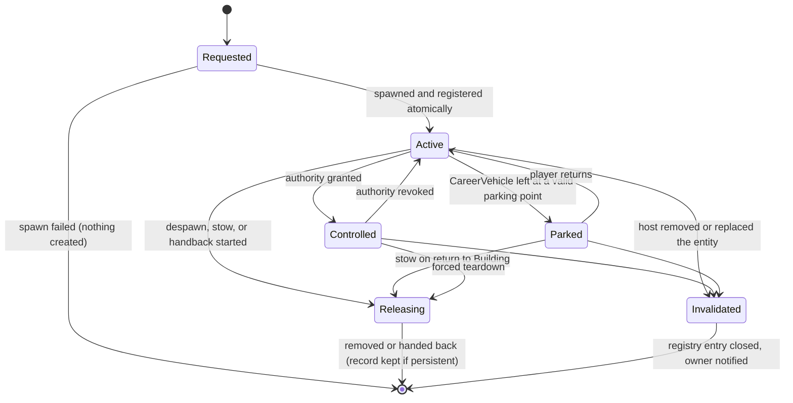

# Entity Lifecycle

| Field | Value |
|---|---|
| ID | SPEC-ENTITY |
| Document status | Draft |
| Release scope | v1.0 |
| Phases | PHASE-01 (registry, orphan sweep), PHASE-02 (borrow and handback), PHASE-05 (transitions, removal handling), PHASE-06 (career vehicles and mission objects) |
| Responsible role | Coordinator (maintainer); **critical area**: Reviewer sign-off required for every change; no uncoordinated concurrent edits |
| Related requirements | REQ-ENTITY-001, REQ-ENTITY-002, REQ-ENTITY-003, REQ-TRANS-003, REQ-TRANS-004, REQ-SAVE-003, REQ-WORLD-003, REQ-CITY-004 |
| Related documents | [SPEC-CONTROL](CONTROL_AUTHORITY.md), [SPEC-SAVE](SAVE_FORMAT.md), [SPEC-CONTACT](WORLD_CONTACT.md), [SPEC-TRANSITION](../gameplay/WALK_DRIVE_TRANSITIONS.md), [SPEC-GARAGE](../gameplay/VEHICLE_OWNERSHIP_AND_GARAGE.md), [SPEC-MISSION](../gameplay/MISSION_FRAMEWORK.md), [ADR-0002](decisions/ADR-0002-control-authority.md) |
| Last updated | 2026-10-18 |

> Required invariants restate owner requirements; the registry design, protocols, and numbers are **[Proposal]**.
> Spawning, removal, takeover, and handback mechanisms in the host are unverified (OPEN-011, OPEN-012, OPEN-106).
> Validation status of everything here: **Not run**.

## 1. Purpose

Make every entity the mod touches traceable from creation to removal, so that nothing is left behind (no orphans, no
invisible traffic blockers, no stale lane reservations), nothing native is silently appropriated, and nothing
runtime-specific is trusted across a save and reload.

## 2. Scope and non-goals

In scope: entity categories, per-category lifecycle, the entity registry, the handback protocol, the career-mode
appropriation ban, orphan sweeps, removal during transitions, and the boundary with persistence.

Not in scope: vehicle rules and prices ([SPEC-GARAGE](../gameplay/VEHICLE_OWNERSHIP_AND_GARAGE.md)), mission rules
([SPEC-MISSION](../gameplay/MISSION_FRAMEWORK.md)), proxy geometry ([SPEC-CONTACT](WORLD_CONTACT.md)), and the persisted
record format ([SPEC-SAVE](SAVE_FORMAT.md)).

## 3. Entity categories

| Category | What it is | Created by | Logical owner module | Persisted? |
|---|---|---|---|---|
| `NativeEntity` | Any object created and simulated by CS2 and left untouched (citizens, native vehicles, buildings, props). | Host | Host | Only as a stable reference (`NativeRef`) when a record points to it |
| `BorrowedNativeVehicle` | A native vehicle temporarily controlled in **sandbox mode only**. | Host (taken over by Vehicles) | Vehicles | Never |
| `Avatar` | The mod-owned on-foot character (REQ-PLAYER-001). | Mod | Player | No (session only) |
| `CareerVehicle` | A mod-spawned vehicle used in career mode. Subtypes **Rental**, **Owned**, **Service**. | Mod | Vehicles (records in Career) | As a record, never as an entity |
| `MissionObject` | Career passengers, career cargo, markers, checkpoints. | Mod | Career (presented through CityBridge) | As part of the mission record |
| `CollisionProxy` | Temporary bounded collision geometry, if that approach is adopted. | Mod | WorldContact | Never |

The **Service** subtype means a mod-spawned vehicle provided for a shift or job (for example a bus for a bus shift, or
a truck that an employer provides for a single job). Vehicles bought through the player's own company are **Owned**
vehicles whose holder is the company rather than the player ([SPEC-COMPANY](../gameplay/COMPANIES_AND_FLEET.md)). The
Service subtype is unrelated to native city-service vehicles (police, fire, garbage), which are `NativeEntity` objects
and are never career vehicles (REQ-ENTITY-002).

Collision proxies may be **data-only** (geometry used by our own queries, creating no host entity) or **host-backed**
(objects created in the engine). Data-only proxies are preferred because they cannot leak into the city; both forms
obey the budgets in [SPEC-CONTACT](WORLD_CONTACT.md).

## 4. Entity registry

The registry lives in CityBridge ([SPEC-MODULES](MODULE_CONTRACTS.md)). The spawn operation refuses to create an entity
without an owner and a lifecycle, and creates the record in the same operation, so an unregistered mod entity cannot
exist by construction.

| Field | Meaning |
|---|---|
| `RegistryId` | Session-unique ID; never persisted |
| `StableId` | Persistent ID for categories that have records (CareerVehicleId, MissionId plus object index); absent otherwise |
| `Category`, `Subtype` | From section 3 |
| `OwnerModule` | The only module that may request lifecycle changes |
| `Lifecycle` | Current state (section 5) |
| `HostHandle` | Runtime reference to the host entity; **never persisted** (REQ-SAVE-003) |
| `AuthorityHolder` | Current movement-authority holder, or none ([SPEC-CONTROL](CONTROL_AUTHORITY.md)) |
| `Links` | Mission ID, rental contract ID, challenge ID, as relevant |
| `CreatedAt`, `ExpiresAt` | Session time; `ExpiresAt` for temporary objects with a lease |

A **census** compares registry counts with the number of mod entities the host reports, where that can be counted
(OPEN-012). A mismatch is a fault ([SPEC-RECOVERY](ERROR_RECOVERY.md)).

## 5. Lifecycle

### 5.1 Per-category lifecycle

| Category | Create / register | Control | Park / idle | Persist | Despawn | Invalidated |
|---|---|---|---|---|---|---|
| BorrowedNativeVehicle | Registered at takeover (TR-03, sandbox) after native movement is suspended and verified | Vehicles driving controller | Never parked by the mod | Never | Never despawned; always handed back (section 6) | Abort transition, avatar to a safe point, close entry, log |
| Avatar | Spawned at TR-01 at a validated spawn point | Avatar, transition, or recovery controller | Attached while `Driving` | Not persisted | TR-02, TR-09, TR-13, `Loading`, `Unloading` | Respawn at a safe point via `Recovery`; if that fails, forced `Building` |
| CareerVehicle / Rental | Spawned after the rental transaction, at a validated access point near the rental service point | Driving controller while `Driving`; hold-only otherwise | Parked at a valid curb or parking point; **stowed** (despawned to its record) on return to `Building` | Record: contract, fuel, wear, stowed location | On stow, contract end, or return | Record marked Missing; no-fault resolution per [SPEC-GARAGE](../gameplay/VEHICLE_OWNERSHIP_AND_GARAGE.md) |
| CareerVehicle / Owned | Spawned from its record at its stowed location (garage, home base, or last parking point), after revalidation | Same | Same | Record: ownership, fuel, wear, upgrades, location | On stow | Record marked Missing; restored at the garage fallback; never silently deleted |
| CareerVehicle / Service | Spawned at a depot or employer access point at shift start (bus shift, company job) | Same | Returned at shift end | Part of the shift or mission record | On shift end or cancellation | Shift cancelled without fault |
| MissionObject | Presented when the leg activates and the player is within presentation range | Scripted boarding or loading only, no free movement | — | Part of the mission record | At leg `Done`, terminal outcome, or return to `Building` | Leg revalidated; if impossible, mission `Invalidated` (no-fault) |
| CollisionProxy | Created by WorldContact inside its budget | None (static) | — | Never | When out of range past its TTL, on budget eviction, on teardown | Rebuilt on demand |

**Stow policy [Proposal]:** on every return to `Building`, all career vehicles are stowed: despawned from the world
and kept as records at a validated parking point, the home garage, or the rental return point. This prevents
career vehicles from blocking native traffic, or being bulldozed, while the player edits the city (RISK-105). On
return to character mode they are respawned after revalidation ([SPEC-CITY](CITY_INTEGRATION.md)).

## 6. Handback protocol (BorrowedNativeVehicle)

Implements REQ-ENTITY-001. The exact host mechanisms are unknown (OPEN-011); the steps are required outcomes.

| Step | Required outcome | Failure response |
|---|---|---|
| H1 Stop | Vehicle stationary at a legal lane position (not inside a junction, not across lanes). If not on a lane, move it to the nearest lane position in its direction of travel at the same level (WorldContact). | No lane position found → keep holding; try again for 2 s; then fallback F1 |
| H2 Release authority | The driving controller stops writing; the registry shows `Releasing`; the write-verify check is disabled. | — |
| H3 Clear presence and blocking state | Every lane-occupancy, presence, or reservation entry that the mod created or altered for this vehicle is removed or restored. Nothing the mod wrote remains. | Log each entry that could not be cleared; fallback F1 |
| H4 Rebuild navigation | Native navigation is rebuilt from the **current** position. The vehicle must not resume path elements computed for its pre-takeover position (no stale route). | Retry once; then fallback F1 |
| H5 Restore native movement | Native movement resumes. The registry entry is closed only after H6. | — |
| H6 Verify rejoin | Within 10 s: the vehicle has a valid route target; it moves when the lane ahead is clear; no mod-created presence entry remains; traffic behind the handback position keeps flowing. | Fallback F1 |

**Fallback F1:** request a fresh native route once more; if verification still fails, use the least invasive native
removal mechanism, if a safe one exists (OPEN-011); always log a detailed `HandbackFailed` record for
[KNOWN_ISSUES](../quality/KNOWN_ISSUES.md) triage. Handback failure in sandbox never affects career data.

**Verification method (through OPEN-011, PHASE-02):** in a lab city, borrow vehicles at known positions, drive them
to another district, hand them back, and observe them for 60 s with a debug overlay that lists lane-occupancy entries
around the handback point before and after. Record: route target present (yes/no), time until movement, residual
entries (count), vehicles passing a virtual gate behind the handback point compared with a control run, and registry
and host entity counts before and after. The candidate base mod's approach (marking navigation obsolete and clearing
path data) is an input to this test, not proof **[Source-inspected, pending re-check in TASK-0002]**.

## 7. Career mode never appropriates native vehicles

REQ-ENTITY-002 **[Owner requirement]**:

- In career mode the vehicle selector considers only registry entries with `Category = CareerVehicle` and a current
  access right (INV-CTRL-10). Native vehicles are not even candidates.
- No operation converts a BorrowedNativeVehicle, or any NativeEntity, into a CareerVehicle record.
- Sandbox mode is visibly labeled, writes no career records, and grants no ownership.
- Career vehicles may use the game's vehicle models only if that is permitted (OPEN-034); this does not make a native
  vehicle the player's.

## 8. Orphan sweeps

| Trigger | Sweep |
|---|---|
| Return to `Building` (TR-02, TR-09) | Avatar despawned; mission objects removed; career vehicles stowed; borrowed vehicle handed back; proxies released |
| `Loading` (another city or save) | Same as above, then registry must be empty; persistent categories exist only as records |
| `Unloading` (quit to menu, game exit, mod disable) | Same; the world may already be torn down, so steps that need the world are skipped and logged, never retried in a loop |
| After every load | Any mod entity found in the loaded world (for example captured by a host save made in character mode) is removed, and career vehicles are respawned only from records |
| Safe-disable switch | As return to `Building` |
| Periodic (every 10 s while in character mode) | Expired leases closed; census check |

Whether a host save captures mod-spawned entities, and what remains in a save when the mod is removed, is unknown
(OPEN-022, OPEN-101). The recommended clean-exit procedure (return to `Building`, save, then disable) is documented in
[INSTALL_UPGRADE_UNINSTALL](../release/INSTALL_UPGRADE_UNINSTALL.md).

## 9. Removal during transitions (REQ-TRANS-003)

| Situation | Response |
|---|---|
| Target vehicle invalidated during `EnteringVehicle` | TR-05 abort; avatar returns to its pre-entry position; camera never stays on the missing entity |
| Vehicle invalidated during `ExitingVehicle` before the avatar detached | Place the avatar at the already-validated exit point if still valid; otherwise `Recovery` |
| Vehicle invalidated during `Driving` | Avatar detached and placed by `Recovery` at the nearest safe point; career vehicle record marked Missing; active mission revalidated |
| Mission object invalidated while boarding | Leg reverts to `Approaching` or the mission is `Invalidated` (no-fault) |
| Avatar invalidated | `Recovery` respawn; failing that, forced `Building` |

Detection of host-side deletion is unverified (OPEN-106); until it is answered, each controller validates its entity
before every write.

## 10. Persistence boundary

- Persisted data holds stable IDs and descriptors, never `HostHandle` values (REQ-SAVE-003). References to native
  objects use `NativeRef` (kind, stable host key if one exists, plus a descriptor for re-resolution; OPEN-103).
- After load, records are revalidated before any entity is spawned from them ([SPEC-SAVE](SAVE_FORMAT.md)).
- Transitional states are never persisted (INV-CTRL-08).

## 11. Invariants

| ID | Invariant | Test |
|---|---|---|
| INV-ENT-01 | Every mod-created entity has exactly one registry record with an owner and a lifecycle. | TEST-ENTITY-003 |
| INV-ENT-02 | Only the owner module requests lifecycle changes of its records. | Review; logic tests |
| INV-ENT-03 | A BorrowedNativeVehicle exists only in sandbox mode and always ends handed back or logged as `HandbackFailed`. | TEST-ENTITY-001 |
| INV-ENT-04 | No career record ever refers to a native vehicle as owned, rented, or service. | TEST-ENTITY-002 |
| INV-ENT-05 | After `Loading`, `Unloading`, or safe-disable, the registry holds no live entity. | TEST-ENTITY-003 |
| INV-ENT-06 | No runtime handle is persisted. | TEST-SAVE-003 |
| INV-ENT-07 | No mod-created lane presence or reservation survives the release of its vehicle. | TEST-ENTITY-001 |

## 12. Acceptance criteria

| Criterion | Test | Validation |
|---|---|---|
| A handed-back vehicle rebuilds its route, leaves no blocker, and rejoins traffic. | TEST-ENTITY-001 | Not run |
| Career mode cannot enter or claim a native vehicle. | TEST-ENTITY-002 | Not run |
| No orphan remains after mission end, mode change, save, unload, or disable (entity counts before and after). | TEST-ENTITY-003 | Not run |
| Vehicle removal during entry or exit aborts safely. | TEST-TRANS-003 | Not run |
| Ending a drive distinguishes park, handback, and temporary-object removal. | TEST-TRANS-004 | Not run |

## 13. Open questions and risks

- OPEN-011 (takeover and handback), OPEN-012 (spawn, removal, counting), OPEN-022 (save after removal), OPEN-034
  (vehicle models), OPEN-101 (save events), OPEN-103 (stable native references), OPEN-106 (invalidation detection),
  OPEN-110 (sandbox exposure).
- RISK-004 (AI and player conflict), RISK-017 (unloadable saves), RISK-105 (career vehicles obstructing traffic).

Register: [RISKS_AND_OPEN_QUESTIONS](../planning/RISKS_AND_OPEN_QUESTIONS.md).
