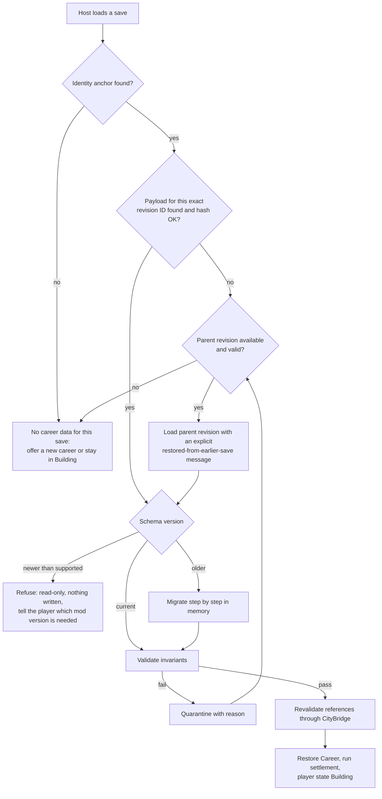

# Save Format and Persistence

| Field | Value |
|---|---|
| ID | SPEC-SAVE |
| Document status | Draft |
| Release scope | v1.0 |
| Phases | PHASE-01 (identity, storage spike, protocols), PHASE-06 (mid-mission save/load), PHASE-07 to PHASE-09 (new record types), PHASE-12 (30-cycle validation), PHASE-13 (clean exit) |
| Responsible role | Coordinator (maintainer); **critical area**: Reviewer sign-off required for every change; no uncoordinated concurrent edits; schema changes also require a migration and its tests |
| Related requirements | REQ-SAVE-001 to REQ-SAVE-006, REQ-ECON-002, REQ-CAREER-004, REQ-TIME-004, REQ-COMPANY-003, REQ-CITY-004, REQ-RECOV-002 |
| Related documents | [ADR-0003](decisions/ADR-0003-career-save-isolation.md), [SPEC-ENTITY](ENTITY_LIFECYCLE.md), [SPEC-TIME](GAME_TIME_AND_PAUSE.md), [SPEC-RECOVERY](ERROR_RECOVERY.md), [SAVE_SAFETY_TESTS](../quality/SAVE_SAFETY_TESTS.md), [INSTALL_UPGRADE_UNINSTALL](../release/INSTALL_UPGRADE_UNINSTALL.md), [SPEC-MISSION](../gameplay/MISSION_FRAMEWORK.md) |
| Last updated | 2026-10-18 |

> Revision-bound identity, stable references, schema versions, atomic writes where possible, quarantine, and the
> no-leak rule are **[Owner requirement]**. The record layout and protocols are **[Proposal]**. **No host save hook
> is assumed to exist:** the storage mechanism is pending OPEN-006 and ADR-0003. Validation status: **Not run**.

## 1. Purpose

Make career data (wallet, ledger, vehicles, missions, company, progress) belong to exactly one save of one city, so
that loading any save shows exactly that save's career, never data from a newer session; and make every write and
load safe against corruption, version changes, and missing references.

## 2. Scope and non-goals

In scope: save identity, schema versioning, record types, stable references, storage options, write and load
protocols, the no-leak rule, migration, quarantine and last valid copy, behavior when the mod is disabled or removed,
test safety.

Not in scope: the meaning of each record's fields (owned by the gameplay specs), settings storage (Diagnostics,
[SPEC-MODULES](MODULE_CONTRACTS.md)), host save files themselves (never modified outside the host's own save flow).

## 3. Save identity

| Element | Definition **[Proposal]** | Source |
|---|---|---|
| City identity | A mod-generated unique ID assigned when a career is first started in a city, carried forward in every later revision of that city's saves | Needs a place inside the save (In-save or Hybrid) or a reliable host-provided city identifier (OPEN-006) |
| Career profile ID | Unique ID of the career profile; v1.0 uses one profile per city lineage, but the field allows more later | Mod |
| Save revision ID | A new unique ID generated at every save event; never reused | Mod, at each host save (OPEN-101) |
| Parent revision ID | The revision that was loaded before this one was saved (lineage) | Mod |
| Schema version | Integer version of our persisted format, written first, independent of any host version value | Mod |

City name and save name are **descriptors** for display and diagnostics only; they never identify data, because
players rename cities and reuse save names.

## 4. Record types

| Record | Scope | Content (summary) | References |
|---|---|---|---|
| Header | Per revision | City identity, profile ID, revision ID, parent revision ID, schema version, mod version, real time written, simulation time at save, career-active time, content hash | — |
| Career profile | Per profile | Creation data, mode flags, tutorial progress, unlocks | — |
| Wallet and ledger | Per profile | Append-only entries: TransactionId, kind, amount, cause reference, career-active and simulation time; the balance is derived and checked | MissionId, CareerVehicleId, CompanyId |
| Progression | Per profile | XP per career, reputation | — |
| Career vehicles | Per vehicle | CareerVehicleId, subtype (Rental, Owned, Service), class and model reference (OPEN-034), fuel, wear, upgrades, stowed location, rental contract | `AccessPointRef` |
| Missions | Per mission | MissionId, career, lifecycle state, ordered legs and their states, remaining career-active time, seeds, settlement status | `AccessPointRef`, `NativeRef` |
| Company | Per company | CompanyId, managerial employees and fleet records, contracts, `settledUntil` checkpoints per account | Vehicle and contract IDs |
| Home and service points | Per profile | Place references, access points, last validation stamp | `PlaceRef`, `AccessPointRef` |
| Challenge results | Per profile | Challenge definition ID, route definition fingerprint, best results | `AccessPointRef` |
| Not persisted per save | — | Settings, key bindings, accessibility (per user, Diagnostics); registry; avatar position; transitional states; collision proxies | — |

## 5. Stable references (REQ-SAVE-003)

- Mod-owned objects use mod-generated IDs (CareerVehicleId, MissionId, CompanyId, ProfileId).
- Native objects are referenced by `NativeRef = (kind, stable host key if one exists, descriptor)`. The descriptor
  (position, type, frontage, name hash) allows re-resolution if no stable key exists (OPEN-103).
- `PlaceRef` wraps a `NativeRef` to a building or stop; `AccessPointRef` adds lane reference, offset, level, and the
  validation stamp ([SPEC-CITY](CITY_INTEGRATION.md)).
- Raw runtime entity handles are never persisted; after load, every reference is revalidated before use.

## 6. Storage options (decision pending: OPEN-006, ADR-0003)

| Criterion | In-save | Sidecar (revision-bound) | Hybrid (anchor in save, payload in sidecar) |
|---|---|---|---|
| Requires a host capability to store custom data in the save | Yes (unverified) | No | Yes, but only a small anchor |
| Requires reliable detection of save events | Provided by the save flow itself, if available | Yes (OPEN-101) | Yes for the payload |
| Revision binding | Natural: data travels inside the save | Must be derived: needs a save fingerprint or identifier that the mod can read on load (OPEN-006) | Anchor carries the revision ID; payload looked up by it |
| Atomic write under our control | No: governed by the host save | Yes: temp file, verify, atomic rename | Yes for the payload; anchor is tiny |
| Survives copying the save to another machine or cloud sync | Yes | No (RISK-101) | Anchor yes, payload no (RISK-101) |
| Effect if the mod is removed | Depends on the host (OPEN-022) | City save untouched; sidecar unused | Anchor fate depends on the host; payload unused |
| Garbage collection | Host deletes with the save | Mod must manage (OPEN-108) | Mod must manage payloads (OPEN-108) |
| Debuggability and quarantine | Harder (data inside the host file) | Easy | Easy for the payload |

Community documentation describes a way for code mods to serialize their own data with the save, and states that
removing the mod drops that data while keeping the city **[Documented upstream, community; unverified]**
([SOURCES](../research/SOURCES.md)). This is an input to the PHASE-01 spike, not a decision.

## 7. Write protocol (REQ-SAVE-004)

Career data is written only together with a host save, so that it is always bound to a revision **[Proposal]**.
Progress made after the last save is lost on a crash together with the city's own progress, which keeps both
consistent.

1. **Prepare:** run pending time-based settlement ([SPEC-TIME](GAME_TIME_AND_PAUSE.md)); take an immutable snapshot at
   a frame boundary; transitional states are recorded as their last stable state (INV-CTRL-08).
2. **Validate:** wallet equals the sum of ledger entries; TransactionIds unique; every reference well-formed; schema
   version current; no runtime handle present.
3. **If validation fails:** do **not** write the snapshot. Write the last validated snapshot instead (In-save) or keep
   the previous revision (Sidecar, Hybrid); quarantine the invalid snapshot with the failure reason; mark Career
   Degraded; tell the player that career progress since the last valid point could not be saved.
4. **Serialize** with the header (section 4) and a content hash (for example SHA-256 **[Proposal]**).
5. **Sidecar or Hybrid payload:** write to a temporary file in the same folder → flush → read back and verify the hash
   → atomically rename to the immutable revision file → update the per-city index through the same temp-and-rename
   pattern. Revision files are never edited in place.
6. **In-save or Hybrid anchor:** hand the serialized block (or anchor) to the host's save flow only after step 2
   succeeded. Atomicity is the host's; the protection is that nothing partial or invalid is ever handed over.
7. **Retain:** earlier revisions stay as last valid copies according to the retention policy (OPEN-108). A revision that
   may still be referenced by an existing save is never deleted automatically when that cannot be determined.

If the host save succeeds but the payload write fails, loading that save later falls back to the parent revision with
an explicit message (section 8). Older data is shown, never newer data.

## 8. Load protocol

- Unresolved references in step "Revalidate" do not fail the load: affected records are marked Missing and resolved by
  their owning specification (no-fault mission cancellation, vehicle at garage fallback, home base fallback).
- The fallback chain only walks to **ancestors** (parent revisions), never to descendants or siblings.
- With Sidecar only, "identity anchor found" means the save fingerprint read from the host matched exactly one index
  entry; any ambiguity is treated as "no".

## 9. No-leak rule (REQ-SAVE-001)

**Rule:** loading a save may show only career data from that save's revision or, as an explicit fallback, from one of
its ancestors. Data written after that save was made (descendants or other branches) is never shown.

**Worked example:**

| Step | Action | Revision written | Wallet in that revision |
|---|---|---|---|
| 1 | Start a career in a new city, save as "Harbor A" | R1 (parent none) | 1,000 |
| 2 | Earn 800, save as "Harbor B" | R2 (parent R1) | 1,800 |
| 3 | Load "Harbor A" | — (reads R1) | Shows **1,000**; R2 untouched |
| 4 | Earn 300, overwrite "Harbor A" | R3 (parent R1) | 1,300 |
| 5 | Load "Harbor B" | — (reads R2) | Shows **1,800** |
| 6 | Payload R3 is corrupt; load "Harbor A" | — (R3 quarantined, falls back to R1) | Shows **1,000** with a message; never 1,800 |

A design that keyed career data by city name, or kept one "latest" career file per city, would show 1,800 at step 3.
That design is forbidden.

## 10. Migration policy (REQ-SAVE-002)

- Forward-only. Each schema step is a pure function from version N to N+1, chained as needed, and tested with golden
  fixtures for every historical version ([SAVE_SAFETY_TESTS](../quality/SAVE_SAFETY_TESTS.md)).
- Migration runs in memory. The original revision stays untouched; migrated data is written only as a new revision at
  the next successful save.
- Any change to the persisted shape bumps the schema version and ships with its migration and fixture in the same
  change (Reviewer sign-off).
- Data with an unknown newer schema is refused without modification (section 8). Downgrading the mod does not
  downgrade data; this is documented for players.

## 11. Quarantine and last valid copy

- Quarantine keeps invalid payloads and snapshots, with the reason, the mod version, and the time, in a mod-owned
  quarantine area. They are never loaded and never deleted automatically.
- The last valid copy is the most recent revision that passed validation in the current lineage. No code path may
  overwrite it with data that failed validation (INV-SAVE-04).
- The diagnostics export includes quarantine metadata; payload contents only with the player's explicit consent.

## 12. When the mod is disabled or removed (REQ-SAVE-006)

- The city must remain loadable without the mod. Whether and how a save made with the mod loads without it, and what
  remains of the mod's data, is unverified (OPEN-022; first lab test in PHASE-01, again in PHASE-13).
- Mod-spawned entities could be captured by a host save made in character mode. The recommended clean-exit procedure
  is: return to `Building` (which stows everything), save, then disable the mod
  ([INSTALL_UPGRADE_UNINSTALL](../release/INSTALL_UPGRADE_UNINSTALL.md)). After load with the mod, the orphan sweep
  removes any captured mod entity ([SPEC-ENTITY](ENTITY_LIFECYCLE.md)).
- If a save is re-saved without the mod, its anchor may disappear. Career data is then not reattached automatically,
  because automatic reattachment could leak newer data; it stays in storage and is reported in diagnostics.
- No safe-uninstall claim is made before REQ-REL-002 tests pass.

## 13. Test safety

- All persistence tests use lab cities and copies; the owner's primary saves are never opened by test procedures
  (RISK-028, [TOOLS_AND_PERMISSIONS](../agents/TOOLS_AND_PERMISSIONS.md)).
- Fault injection (disk full, write interrupted, corrupt payload, missing payload, newer schema) is part of
  [SAVE_SAFETY_TESTS](../quality/SAVE_SAFETY_TESTS.md).

## 14. Invariants

| ID | Invariant | Test |
|---|---|---|
| INV-SAVE-01 | A load reads only its own revision or, as a fallback, an ancestor. | TEST-SAVE-001 |
| INV-SAVE-02 | Schema version is read first; an unknown newer schema is refused with no write. | TEST-SAVE-002 |
| INV-SAVE-03 | No runtime handle is persisted; every reference is revalidated on load. | TEST-SAVE-003 |
| INV-SAVE-04 | Data that failed validation never overwrites the last valid copy. | TEST-SAVE-004 |
| INV-SAVE-05 | A mid-mission save resumes or resolves the mission with no duplicated reward or lost entity. | TEST-SAVE-005 |
| INV-SAVE-06 | Ledger entries and settlement checkpoints are persisted in the same snapshot. | TEST-TIME-004 |
| INV-SAVE-07 | Quarantined data is never loaded or auto-deleted. | TEST-SAVE-004 |

## 15. Failure handling

| Failure | Response |
|---|---|
| Write interrupted or disk full | Temp file discarded; previous revision intact; player told; Career keeps running |
| Snapshot invalid | Section 7 step 3 |
| Payload missing or corrupt on load | Quarantine; ancestor fallback; or no career data |
| Newer schema | Refuse read-only |
| Migration throws | Quarantine; ancestor fallback |
| Identity ambiguous (Sidecar) | Treat as no career data; never guess |
| Clock regression detected after load | No settlement; log; identity check ([SPEC-TIME](GAME_TIME_AND_PAUSE.md)) |

## 16. Acceptance criteria

| Criterion | Test | Validation |
|---|---|---|
| Older save never shows newer data (section 9 sequence in a lab city). | TEST-SAVE-001 | Not run |
| Older schemas migrate; newer schemas are refused without loss. | TEST-SAVE-002 | Not run |
| References are stable and revalidated on load. | TEST-SAVE-003 | Not run |
| Atomic writes; corrupt data quarantined; last valid copy preserved. | TEST-SAVE-004 | Not run |
| Save/load during an active mission without duplicate rewards or lost entities. | TEST-SAVE-005 | Not run |
| Disabling or removing the mod leaves the city loadable; behavior documented. | TEST-SAVE-006 | Not run |
| Proposed PHASE-12 gate: 30 save/load cycles with no corruption or duplication. | [SAVE_SAFETY_TESTS](../quality/SAVE_SAFETY_TESTS.md) | Not run |

## 17. Open questions and risks

- OPEN-006 (mechanism and identity), OPEN-022 (mod removal), OPEN-101 (save events), OPEN-103 (stable native
  references), OPEN-108 (sidecar retention without enumerating saves).
- RISK-005 (corruption or leakage), RISK-006 (duplicated money), RISK-017 (unloadable saves), RISK-028 (primary saves),
  RISK-101 (sidecar separated from its save).

Register: [RISKS_AND_OPEN_QUESTIONS](../planning/RISKS_AND_OPEN_QUESTIONS.md).
