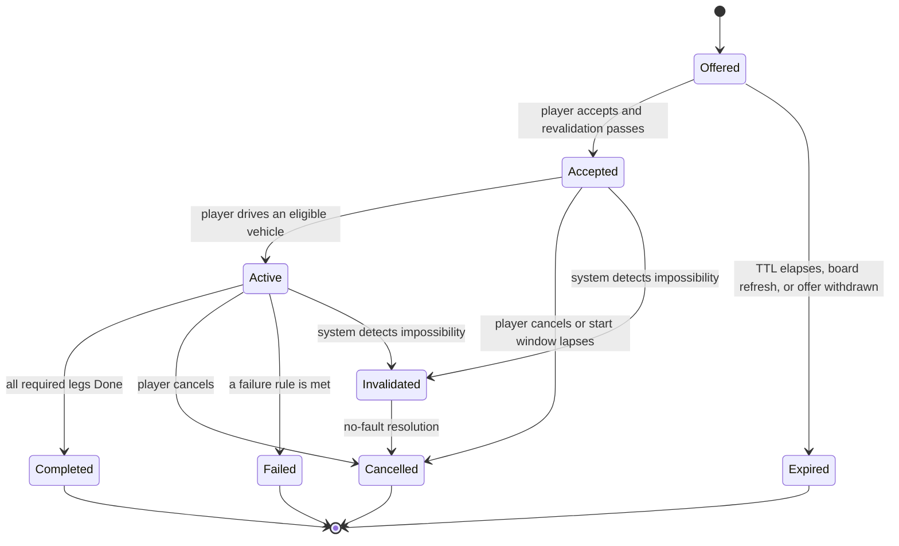

# Mission Framework

| Field | Value |
|---|---|
| ID | SPEC-MISSION |
| Document status | Draft |
| Release scope | v1.0 |
| Phases | PHASE-06 (lifecycle, settlement, taxi), PHASE-08 (multi-leg careers, line replanning), PHASE-10 (city-edit reaction, demand-informed generation) |
| Responsible role | Coordinator (maintainer); Implementer of the Career module; Reviewer review required for any change to settlement or persisted mission data |
| Related requirements | REQ-CAREER-001 to REQ-CAREER-006, REQ-SAVE-005, REQ-ECON-002, REQ-TIME-002, REQ-TIME-004, REQ-CITY-002, REQ-CITY-003, REQ-ENTITY-003, REQ-UI-003 |
| Related documents | [SPEC-ECON](PROGRESSION_AND_ECONOMY.md), [SPEC-TAXI](careers/TAXI.md), [SPEC-DELIVERY](careers/DELIVERIES.md), [SPEC-FREIGHT](careers/FREIGHT.md), [SPEC-BUS](careers/BUS.md), [SPEC-CHALLENGE](CHALLENGES_AND_DYNAMIC_CITY.md), [SPEC-CITY](../architecture/CITY_INTEGRATION.md), [SPEC-TIME](../architecture/GAME_TIME_AND_PAUSE.md), [SPEC-SAVE](../architecture/SAVE_FORMAT.md), [SPEC-ENTITY](../architecture/ENTITY_LIFECYCLE.md), [SPEC-MODULES](../architecture/MODULE_CONTRACTS.md), [ADR-0003](../architecture/decisions/ADR-0003-career-save-isolation.md) |
| Last updated | 2026-10-18 |

> **Status:** behavior and rules specification. Nothing is implemented or tested. Values are **[Proposal]**.
> Validation: **Not run**. The persisted format is defined only in [SPEC-SAVE](../architecture/SAVE_FORMAT.md).

## 1. Purpose

Every career (taxi, deliveries, freight, bus) and every challenge uses this one mission lifecycle (REQ-CAREER-001).
This document defines its states, validation before offering, legs, cancellation and failure, invalidation by city
edits, exactly-once settlement, save/load behavior, and the extension points each career fills in. The rules are written
so that the Career module can implement them as **pure logic, testable without CS2**. City data arrives through ports
that CityBridge adapters implement ([SPEC-MODULES](../architecture/MODULE_CONTRACTS.md)).

## 2. Scope and non-goals

**In scope:** player-driven missions in career mode and challenge runs ([SPEC-CHALLENGE](CHALLENGES_AND_DYNAMIC_CITY.md)).
**Not in scope:** company contracts run by employees. Those are a managerial simulation that settles per period
([SPEC-COMPANY](COMPANIES_AND_FLEET.md)) and never creates missions in the world. Also out of scope: native citizen
trips and native goods (REQ-CITY-003), and missions in Sandbox mode, which has no missions.

## 3. Lifecycle

| State | Meaning | Timers that run (career clock, §6) |
|---|---|---|
| `Offered` | Generated and validated; visible on a job board or in in-vehicle dispatch. Not persisted (§9). | Offer TTL: 5 min **[Proposal]** |
| `Accepted` | The player committed. Mission objects may be reserved. | Start window: 10 min **[Proposal]** |
| `Active` | The player is in an eligible vehicle. Legs progress in order. | Leg windows, deadlines, patience |
| `Completed` | All required legs reached `Done` (possibly with partial outcomes, such as a damaged parcel). | — |
| `Cancelled` | Ended by the player, by a lapsed start window, or by no-fault resolution of `Invalidated`. Carries a `Fault` flag: `Player` or `NoFault`. | — |
| `Failed` | A career failure rule was met (§7.2). | — |
| `Invalidated` | Transient. The system detected that the mission cannot continue; it resolves immediately to a no-fault `Cancelled`. | — |
| `Expired` | An offer that was never accepted. Never settled. | — |

**Concurrency [Proposal]:** at most one mission is `Accepted` or `Active` per profile in v1.0. Multi-stop work
(delivery routes, bus shifts) is modeled as legs of one mission. Accepting another offer is blocked with an
explanation.

## 4. Legs

An active mission has an ordered list of **leg groups**. Each group holds one or more legs. Groups are done in order;
legs inside a group may be done in any order. A group usually holds one leg, and a delivery contract may group its
drop-offs. This keeps "ordered legs" (REQ-CAREER-001) while allowing route choice.

Each leg has three states: `Approaching` → `Servicing` → `Done`.

| Leg field | Content |
|---|---|
| Kind | Pickup, Dropoff, Load, Unload, Stop (bus: alight then board), Checkpoint, Park |
| Access point | A stable reference to a validated access point: curbside, stop, loading bay, or parking (REQ-CAREER-003). Never a building center. |
| Servicing rule | Arrive within radius R of the access point, speed below v, then hold for duration t. Defaults: R 15 m, v 0.5 m/s, t set by the career **[Proposal]**. Moving above v pauses or restarts servicing as the career defines. |
| Time window | Optional earliest and latest career-clock time |
| Required | Mandatory or optional. Optional legs never block completion. |
| Outcome | Done-OK, Done-Partial (with details), or Skipped-NoFault |

`Approaching` shows route guidance to the access point ([SPEC-UI](../experience/UI_AND_HUD.md), REQ-UI-004).
`Servicing` shows progress, such as a boarding bar. `Done` records the outcome and starts the next group.

## 5. Generation and validation before offering

Pipeline (REQ-CAREER-002, REQ-CAREER-003):

1. **Generate.** The career's `OfferGenerator` (§11) proposes candidate contracts. It works from a read-only city
   snapshot supplied by CityBridge ([SPEC-CITY](../architecture/CITY_INTEGRATION.md)) and from demand weights
   ([SPEC-CHALLENGE](CHALLENGES_AND_DYNAMIC_CITY.md), REQ-CHAL-003).
2. **Validate access points.** Every leg's access point must exist, be of the right kind for the leg, and fit the
   vehicle class (length, turning). Class-aware validation is OPEN-203; how access points are found is OPEN-018.
3. **Validate connectivity.** A road route must exist from the **start position** to the first leg, and between
   consecutive leg groups. The start position is the eligible vehicle's position, or the road access point nearest
   the player when on foot. Mechanism: OPEN-019.
4. **Validate bands.** Route distance and estimated time fall inside the career's bands.
5. **Check eligibility.** The player has, or can reach, an eligible vehicle: owned, active rental, or a reachable
   rental desk ([SPEC-GARAGE](VEHICLE_OWNERSHIP_AND_GARAGE.md)). Level and unlock requirements apply
   ([SPEC-ECON](PROGRESSION_AND_ECONOMY.md)). Ineligible offers may appear greyed out with the reason and a next step
   (REQ-UI-003).
6. **De-duplicate.** No two simultaneous offers share a pickup access point within 50 m **[Proposal]**.
7. **Publish** with a TTL and a fare or pay estimate (REQ-TAXI-003 for taxi).

On acceptance, steps 2–3 run again quickly. If either fails, the player sees "Offer no longer available" and the offer
becomes `Expired` (reason: Withdrawn) with no consequence.

## 6. Time

All mission timers run on the **career clock** **[Proposal]**. It advances only in stable character-mode states
(`OnFoot`, `Driving`, and also during transitions), and is frozen in `Paused`, `Menu`, `Loading`, `Unloading`, and
`Building`. The clock value is persisted as a checkpoint, so closing the game never consumes mission time, and
save/load cannot skip or repeat time (REQ-TIME-002, REQ-TIME-004).

Whether deadlines should instead follow CS2's in-game clock is **OPEN-201**. The normative clock definitions are owned
by [SPEC-TIME](../architecture/GAME_TIME_AND_PAUSE.md). If SPEC-TIME chooses differently, this section follows it.

## 7. Ending a mission

### 7.1 Player cancellation (REQ-CAREER-005)

The player may cancel any `Accepted` or `Active` mission from the mission panel, after one confirmation that shows the
consequence. Default consequences **[Proposal]**; careers may adjust them within these bounds:

| When | Pay | Fee | Reputation | Mission objects |
|---|---|---|---|---|
| `Accepted`, or start window lapses | — | none | −1 | Released |
| `Active`, no leg `Done` | — | none | −2 | Passengers alight at the next valid curb; cargo is returned automatically |
| `Active`, some legs `Done` | 50% of the `Done` legs' share | 10% of contract value, capped by SPEC-ECON | −3 | As above |

A fee never pushes the wallet below zero. Any excess becomes a deferred charge ([SPEC-ECON](PROGRESSION_AND_ECONOMY.md)).
No cancellation makes the career unrecoverable.

### 7.2 Failure

Failure needs a rule attributable to the player. Generic rules **[Proposal]**; careers specialize them:
- a hard deadline is missed;
- all mission objects are destroyed (for example, cargo integrity reaches 0);
- **abandonment:** the player is more than 300 m from the mission vehicle, with mission objects aboard, for more than
  3 career-clock minutes;
- a career-specific rule, such as passenger patience exhausted.

Out of fuel or condition 0% does **not** fail a mission by itself. The player can recover (SPEC-GARAGE), but deadlines
keep running because the cause was preventable.

### 7.3 Invalidation (REQ-CAREER-006)

**Triggers:** return from `Building` (REQ-CITY-002); loading a save; activation of each new leg; a watchdog every 60
career-clock seconds that re-checks the route to the current leg; entity-loss events for the mission vehicle or mission
objects that the player did not cause.

**Resolution order** for an invalid leg:

1. Use an alternate validated access point of the same building or stop (SPEC-CITY).
2. Apply the career's substitution policy (for example, a taxi passenger accepts a nearby destination, or a bus line is
   replanned).
3. If only the route broke, recalculate the route.
4. Otherwise mark the leg `Skipped-NoFault`. If the mission can no longer complete meaningfully, it becomes
   `Invalidated` and then a no-fault `Cancelled`.

**Bound:** if two consecutive checks find no way to make progress, the mission is invalidated. No mission stays
impossible indefinitely.

**No-fault settlement:** `Done` legs are paid at 100% of their share. There is no fee and no reputation change, and XP
is granted for `Done` legs. Recovery that the system triggers extends deadlines by its duration. Recovery the player
requests does not.

## 8. Settlement (exactly once)

Every **accepted** mission that reaches a terminal state (`Completed`, `Cancelled`, or `Failed`) settles **exactly once**
(REQ-CAREER-004). `Expired` offers never settle.

1. The career's `SettlementCalculator` computes a `SettlementResult`. It is a pure, deterministic function of the
   mission record: contract terms, leg outcomes, evaluation accumulators, and fault. It contains money lines, XP per
   career, and the reputation delta.
2. **TransactionId** = `MS-<MissionId>-<Outcome>` **[Proposal]**. `MissionId` = profile ID + a persisted per-profile
   sequence number + a random nonce chosen at generation. This makes it unique within a save line and deterministic for
   a given mission and outcome.
3. The ledger ([SPEC-ECON](PROGRESSION_AND_ECONOMY.md)) appends **one settlement entry**, even when the net amount is
   zero. It enforces two invariants: (a) a duplicate TransactionId is rejected as `AlreadySettled`, a no-op; (b) at most
   one settlement exists per MissionId, so a bug cannot settle both `Completed` and `Failed`.
4. The wallet balance, XP, and reputation are applied in the **same in-memory commit** as the ledger append and the
   mission's terminal state. A save snapshot therefore always shows all of them or none.
5. Replayed events (a repeated arrival trigger, a reload, a duplicated UI click) reach a terminal mission or a
   duplicate TransactionId and change nothing.

## 9. Save, load, and mode switches (REQ-SAVE-005)

**Persisted** (format in [SPEC-SAVE](../architecture/SAVE_FORMAT.md)): the `Accepted` or `Active` mission record (terms,
leg groups and states, outcomes, evaluation accumulators, career-clock checkpoints, the mission vehicle's stable
VehicleRecordId), mission-object records (passenger groups, cargo items with integrity), the MissionId sequence, and a
capped history of terminal missions (last 200 **[Proposal]**). **Not persisted:** offers, which are regenerated after
load, and partly finished servicing steps, which restart.

**On load:**
1. SPEC-SAVE confirms the save identity.
2. Revalidate per §7.3.
3. Respawn mission objects in the vehicle or at their waiting point ([SPEC-ENTITY](../architecture/ENTITY_LIFECYCLE.md)).
4. Resume timers from the checkpoint.
5. If the mission cannot resume, it becomes `Invalidated` and then a no-fault `Cancelled`.

Loading an older save restores that save's mission and ledger state only. Nothing from a newer session appears
(REQ-SAVE-001).

**Returning to `Building`** with an active mission is allowed (REQ-CTRL-004). The mission is suspended (career clock
frozen), and its objects are stored with the vehicle per SPEC-ENTITY. On return, revalidation runs before timers resume.

## 10. Feedback

Accept and cancel confirmations always state the consequence. Leg changes, reroutes, substitutions, and no-fault
cancellations always show a reason, such as "Destination was removed from the city. You were paid for completed stops."
Settlement opens a breakdown with lines, XP, and reputation. Presentation details are in [SPEC-UI](../experience/UI_AND_HUD.md).

## 11. Career extension points

| Extension point | Responsibility | Taxi | Deliveries | Freight | Bus |
|---|---|---|---|---|---|
| OfferGenerator | Candidate contracts from city data | Origin/destination pairs | Pickup plus drop sets | Industrial/commercial pairs | Line and stop range |
| Eligibility | Vehicle class, capacity, unlocks | Car | Car or van | Rigid truck plus payload | Bus (service vehicle) |
| MissionObjectFactory | Career passengers or cargo | Passengers | Parcels | Freight loads | Passenger groups |
| ServicingRule | R, v, t; interruption policy | Boarding/alighting | Per-parcel handling | Bay positioning | Doors, dwell |
| EvaluationModel | Accumulates quality from ContactEvents and acceleration | Ride rating | Cargo integrity, punctuality | Load safety, precision | Comfort, punctuality |
| FailureRules | Career rules from §7.2 | Patience, severe contacts | Hard deadline, integrity | Hard deadline, damage | Shift abandonment |
| SubstitutionPolicy | Reaction to invalid legs | Nearby destination | Skip parcel (no fault) | Alternate bay | Line replanning |
| SettlementCalculator | Pure pay, XP, and reputation | Fare | Parcels | Mass × distance | Stops and passengers |

Generation inputs from city data (read-only, through CityBridge): access points by kind, building category and
district, the road graph with route distance and time, transit lines and stop order, in-game time of day, the player's
position, vehicle, level and reputation, and recent mission history (to avoid repeats). Reading is never a write to
native state (REQ-CITY-001, REQ-CITY-003).

## 12. Failure handling of the framework itself

An internal error while processing a mission is contained (REQ-RECOV-002). The mission becomes `Invalidated` and then a
no-fault `Cancelled`, its objects are cleaned up (REQ-ENTITY-003), and diagnostics are logged. If settlement itself
fails, the mission stays `Active`, flagged *settlement pending*, and retries on the next update. Because the
TransactionId is deterministic, a retry cannot double-pay.

## 13. Acceptance criteria

| # | Criterion | Primary test | Validation |
|---|---|---|---|
| 1 | All careers and challenges use the §3 states; illegal transitions are rejected (Logic layer). | TEST-CAREER-001 | Not run |
| 2 | No offer is published with an unreachable access point (disconnected-road lab scenario). | TEST-CAREER-002 | Not run |
| 3 | Every leg uses a validated access point, never a building center. | TEST-CAREER-003 | Not run |
| 4 | Replaying terminal events, reloading, and double-clicking never create a second settlement. Ledger count equals the count of terminal accepted missions. | TEST-CAREER-004 | Not run |
| 5 | Cancellation at each stage applies the §7.1 consequences and leaves the career playable. | TEST-CAREER-005 | Not run |
| 6 | Demolishing a destination, cutting a road, or deleting a line leads to reroute, substitution, or a no-fault cancellation within two checks. | TEST-CAREER-006 | Not run |
| 7 | A save/load mid-mission resumes or resolves safely with no duplicate reward and no lost or duplicated entity. | TEST-SAVE-005 | Not run |
| 8 | Pause, `Building`, and save/load never advance or repeat mission timers. | TEST-TIME-002, TEST-TIME-004 | Not run |

## 14. Open questions and risks

Central ([register](../planning/RISKS_AND_OPEN_QUESTIONS.md)): OPEN-018, OPEN-019, OPEN-021, RISK-006, RISK-018,
RISK-022. New: **OPEN-201** (clock basis for mission deadlines and company periods), **OPEN-203** (class-aware access
point and route validation), **RISK-203** (economy exploits through cancellation and safety nets), **RISK-204** (too
few valid contracts in small or unusual cities).

## 15. Provenance

The shared lifecycle, validation before acceptance, single payment, route-based design, and invalidation by city edits
are **[Owner requirement]**. They also appear in the historical plan in [chat.md](../../chat.md) **[Historical
input]**. Leg groups, the career clock, the TransactionId shape, fault attribution, and the cancellation table are
original proposals. Motor Town's observable job loop (accept → collect → transport → deliver → get paid) is a
behavioral reference only ([MOTOR_TOWN_REFERENCE](../research/MOTOR_TOWN_REFERENCE.md)).
