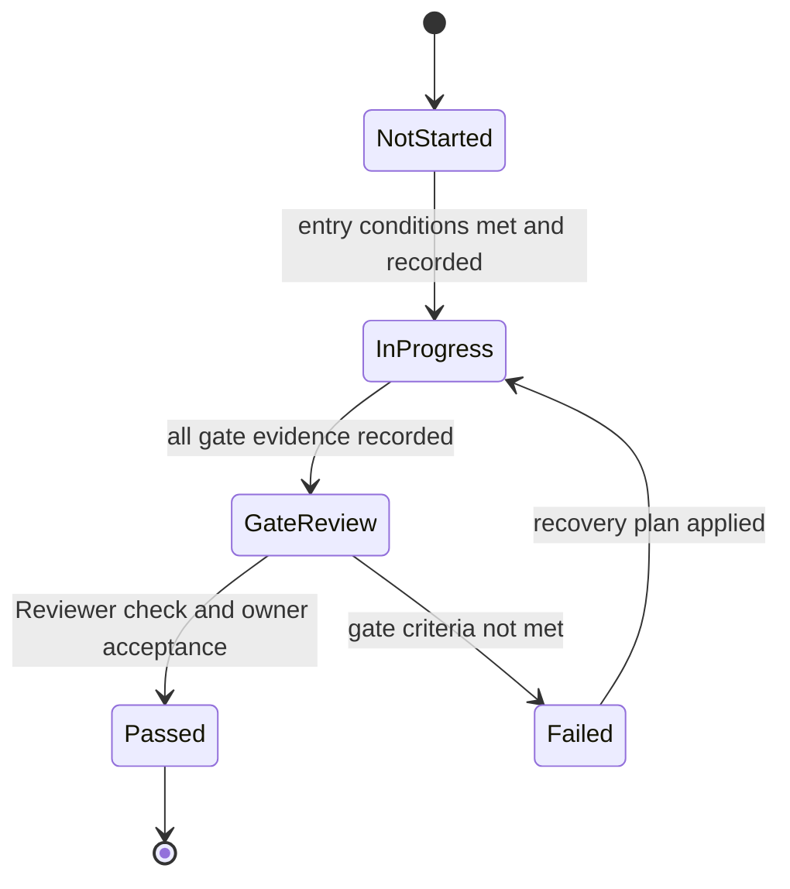

# Phase Documents

| Field | Value |
|---|---|
| ID | DOC-PHASES |
| Document status | Draft |
| Scope | All fourteen v1.0 phases (PHASE-00 – PHASE-13) and milestones M0–M5 |
| Responsible role | Coordinator (maintainer); project owner approves changes to phase gates |
| Related documents | [ROADMAP](../../../ROADMAP.md), [PRD](../../product/PRD.md), [TRACEABILITY](../TRACEABILITY.md), [BACKLOG](../BACKLOG.md), [Tasks](../tasks/README.md), [RISKS_AND_OPEN_QUESTIONS](../RISKS_AND_OPEN_QUESTIONS.md), [TPL-PHASE](../../templates/PHASE_TEMPLATE.md) |
| Last updated | 2026-10-18 |

> **Current position:** pre-development. Every phase below is **Not started**. The documentation baseline
> (TASK-0000) does not start or complete any phase. PHASE-00 needs real discovery, audit, build, and runtime evidence.

## 1. Purpose and authority

Each phase document explains **what a phase must deliver and how its gate is judged**: objective, entry conditions,
dependencies, required reading, deliverables, proposed work packages, exclusions, tests, acceptance gate, risks,
recovery, and the evidence record.

Authority is split as follows:

| Question | Official home |
|---|---|
| Phase order, dependencies, milestones | [ROADMAP.md](../../../ROADMAP.md). If a phase document disagrees, the ROADMAP wins and the phase document is corrected. |
| Requirements and their assigned phases | [PRD](../../product/PRD.md) ("Phase" column). Phase documents list the matching tests; they never create `REQ-*` IDs. |
| Test definitions | [TEST_SCENARIOS](../../quality/TEST_SCENARIOS.md) and [SAVE_SAFETY_TESTS](../../quality/SAVE_SAFETY_TESTS.md). |
| Demonstrated state | [PROJECT_STATUS](../../PROJECT_STATUS.md). A phase document never claims progress. |
| Task status | The task file in [tasks](../tasks/README.md). |

## 2. Phase index

| Phase | Title | Milestone | Depends on (ROADMAP) | Phase status | Document |
|---|---|---|---|---|---|
| PHASE-00 | Audit and Windows environment | M0 | — | Not started | [PHASE-00](PHASE-00-audit-and-windows.md) |
| PHASE-01 | Foundation and save safety | M0 | 00 | Not started | [PHASE-01](PHASE-01-foundation-and-save-safety.md) |
| PHASE-02 | Basic driving | M1 | 01 | Not started | [PHASE-02](PHASE-02-basic-driving.md) |
| PHASE-03 | Surfaces, collisions, and physics | M1 | 02 | Not started | [PHASE-03](PHASE-03-surfaces-collisions-and-physics.md) |
| PHASE-04 | On-foot character | M1 | 03 | Not started | [PHASE-04](PHASE-04-on-foot-character.md) |
| PHASE-05 | Walk–drive integration | M1 | 02, 04 | Not started | [PHASE-05](PHASE-05-walk-drive-integration.md) |
| PHASE-06 | Taxi career MVP | M2 | 05, 01 | Not started | [PHASE-06](PHASE-06-taxi-career-mvp.md) |
| PHASE-07 | Progression and garage | M3 | 06 | Not started | [PHASE-07](PHASE-07-progression-and-garage.md) |
| PHASE-08 | Deliveries, freight, and bus | M3 | 06 (07 for ownership-dependent content) | Not started | [PHASE-08](PHASE-08-delivery-freight-and-bus.md) |
| PHASE-09 | Home, services, and company | M3 | 07 | Not started | [PHASE-09](PHASE-09-home-services-and-company.md) |
| PHASE-10 | Challenges and dynamic city | M4 | 08, 09 | Not started | [PHASE-10](PHASE-10-challenges-and-dynamic-city.md) |
| PHASE-11 | Presentation and accessibility | M4 | 07–10 (UI work may start earlier) | Not started | [PHASE-11](PHASE-11-presentation-and-accessibility.md) |
| PHASE-12 | Beta and validation | M4 | 10, 11 | Not started | [PHASE-12](PHASE-12-beta-and-validation.md) |
| PHASE-13 | Release and maintenance | M5 | 12 | Not started | [PHASE-13](PHASE-13-release-and-maintenance.md) |

Milestones: **M0** Verified foundation (00–01) · **M1** Playable walking/driving sandbox (02–05) · **M2** Taxi-career
MVP (06) · **M3** Content alpha (07–09) · **M4** Refined and validated beta (10–12) · **M5** Distributable v1.0 (13).
A milestone is reached only when all of its phases have Passed.

## 3. Phase lifecycle

| Phase status | Meaning | Who changes it |
|---|---|---|
| Not started | Entry conditions are not yet met, or nobody has begun work. | — |
| In progress | Entry conditions are met and recorded (previous gate Passed with evidence, required owner authorizations granted). At least one task of the phase is active. | Coordinator |
| Gate review | QA has recorded the evidence runs the gate requires. A Reviewer is checking them. | Coordinator |
| Passed | A Reviewer who did not implement the work confirmed the evidence, and the project owner accepted the gate. | Project owner (acceptance); Coordinator records it |
| Failed | The gate was judged and not met. The phase stays open and its section 11 (Recovery) applies. | Coordinator records the Reviewer/owner decision |

A Failed gate is not a terminal state for the project. It returns the phase to In progress with a recorded recovery
plan. If a requirement proves infeasible, the response is a **scope review** recorded in the
[register](../RISKS_AND_OPEN_QUESTIONS.md) as a `CONF-*` entry plus a proposed PRD or ADR change for the owner. A
mandatory requirement is never dropped silently ([DOCUMENTATION_RULES](../../DOCUMENTATION_RULES.md) §8).

## 4. Gate process

1. **Evidence (QA).** Every gate criterion is backed by recorded evidence runs (`RUN-NNNN`) under
   [docs/quality/evidence/](../../quality/evidence/README.md), written with
   [TPL-TEST-REPORT](../../templates/TEST_REPORT_TEMPLATE.md). Compiling is not passing. Documentation is not passing.
2. **Independent review (Reviewer).** A Reviewer who did not implement the work checks the evidence against the
   phase's section 9. Self-review is recorded as self-review and is not independent approval
   ([ROLES_AND_OWNERSHIP](../../agents/ROLES_AND_OWNERSHIP.md)). Phases that change control authority, the entity
   lifecycle, or the save format need a Reviewer scoped to that critical area.
3. **Owner acceptance (project owner).** Only the owner accepts or rejects a gate. Agents never record an approval
   that did not happen.
4. **Records.** After the decision, update in the same change: the phase status (this index and the phase's
   metadata), section 12 of the phase document, [PROJECT_STATUS](../../PROJECT_STATUS.md), the milestone status in the
   [ROADMAP](../../../ROADMAP.md) if a milestone is reached, the evidence cells in [TRACEABILITY](../TRACEABILITY.md),
   and [CHANGELOG.md](../../../CHANGELOG.md).

## 5. Work packages and tasks

- A **work package** (`WP-NN-MM`, where `NN` is the phase number) is a planned slice of a phase, written in that phase's
  section 6. Work packages hold the later-phase work breakdown. They are proposals, not commitments or estimates.
- **Adding a work package:** append it to section 6 with the next free `MM`. Never renumber or reuse an ID. A retired
  work package stays listed and is marked Withdrawn with the reason. Link the requirement IDs and open questions it
  addresses.
- **Promoting a work package to a task:** when a work package is next in line and meets the
  [Definition of Ready](../../agents/DEFINITION_OF_READY.md), create a task file from
  [TPL-TASK](../../templates/TASK_TEMPLATE.md) (see [tasks/README](../tasks/README.md)), add its row to
  [BACKLOG](../BACKLOG.md), and write the task ID into the work package row. One work package may produce several
  tasks.
- Do not create speculative task files for later phases. As of 2026-10-18, only PHASE-00 has task files:
  [TASK-0001](../tasks/TASK-0001-windows-environment-audit.md), [TASK-0002](../tasks/TASK-0002-base-mod-source-audit.md),
  and [TASK-0003](../tasks/TASK-0003-isolated-baseline-validation.md).
- Work allowed early behind stable contracts (pure career logic, UI layout prototypes, string externalization, test
  definitions) follows the [ROADMAP](../../../ROADMAP.md) §5 rules. It is planned as a work package of the phase that
  owns its gate, with a note that it may start earlier.

## 6. Structure of a phase document

Every phase document follows [TPL-PHASE](../../templates/PHASE_TEMPLATE.md): metadata (ID, Document status, Phase
status, Milestone, Responsible role, Related requirements, Last updated), then sections 1 Objective · 2 Entry
conditions · 3 Dependencies · 4 Required reading · 5 Deliverables · 6 Proposed work packages · 7 Out of scope ·
8 Tests · 9 Acceptance gate · 10 Risks and open questions · 11 Recovery · 12 Evidence record.

Test listing conventions:

- Section 8 lists the primary test `TEST-X-NNN` of every requirement whose PRD "Phase" column names that phase. When a
  requirement spans several phases, each phase states which part it validates (for example, "minimal slice" or
  "regression").
- The layer shown (Logic, Integration, In-game; "Review" for non-runtime audit checks) is the expected primary layer.
  The authoritative definition is in [TEST_SCENARIOS](../../quality/TEST_SCENARIOS.md) or
  [SAVE_SAFETY_TESTS](../../quality/SAVE_SAFETY_TESTS.md).
- Campaign quantities (50 transition cycles in PHASE-05, 20 taxi rides in PHASE-06, 30 save/load cycles and sessions of
  at least two hours in PHASE-12) are **proposed acceptance criteria**, not results or effort estimates. Campaign test
  IDs: TEST-TRANS-101, TEST-TAXI-101, TEST-SAVE-109, TEST-SAVE-114, TEST-PERF-107, and TEST-REL-001 for the
  independent acceptance run.
- Every validation status is **Not run** until an evidence run exists.

## 7. Requirement coverage by phase (summary)

The PRD is authoritative. This summary helps readers find the right phase document.

| Phase | Requirement areas validated (primary) |
|---|---|
| PHASE-00 | REL-003 (candidate audit only) |
| PHASE-01 | SAVE-001–004, SAVE-006 (first pass), CITY-001, CITY-004, CTRL-002 (skeleton), ENTITY-003 (registry), RECOV-002, DIAG-001–002, L10N-001 (externalization), COMPAT-001 (base-mod co-load) |
| PHASE-02 | DRIVE-001, CTRL-001–003, ENTITY-001–002, UI-001 (minimal) |
| PHASE-03 | DRIVE-002, DRIVE-003 (car), WORLD-001–004, TIME-001–003, PERF-001 (baseline) |
| PHASE-04 | PLAYER-001–004, WORLD-002 (avatar), RECOV-001 (avatar), ART-001 (first set), ART-002 |
| PHASE-05 | TRANS-001–004, CTRL-002, CTRL-004, ENTITY-003, RECOV-001, UI-003 (first pass) |
| PHASE-06 | TAXI-001–003, CAREER-001–005, ENTITY-002, TIME-004 (career), ECON-001, ECON-002 and GARAGE-001 (minimal), SAVE-005, UI-004 (first pass) |
| PHASE-07 | ECON-002–005, GARAGE-001–006, DRIVE-003 (owned vehicles), UI-002 (first menus) |
| PHASE-08 | DELIV-001, FREIGHT-001, BUS-001–002, CAREER-006 (first pass), DRIVE-003 (remaining classes) |
| PHASE-09 | HOME-001–003, COMPANY-001–003, TIME-004 (company), UI-002 (company) |
| PHASE-10 | CHAL-001–003, CITY-001–003, CAREER-006, BUS-002, HOME-003 |
| PHASE-11 | UI-001–004, ONBOARD-001, INPUT-001–003, L10N-001, ECON-005, DRIVE-004, ART-001–002, AUDIO-001, PERF-002 |
| PHASE-12 | SAVE-002 (migration), PERF-001, COMPAT-001, plus regression of every requirement |
| PHASE-13 | REL-001–004, SAVE-006 (release candidate), COMPAT-001 (declaration) |

REQ-ART-002 (placeholder labeling) applies continuously from PHASE-04 to PHASE-11.
