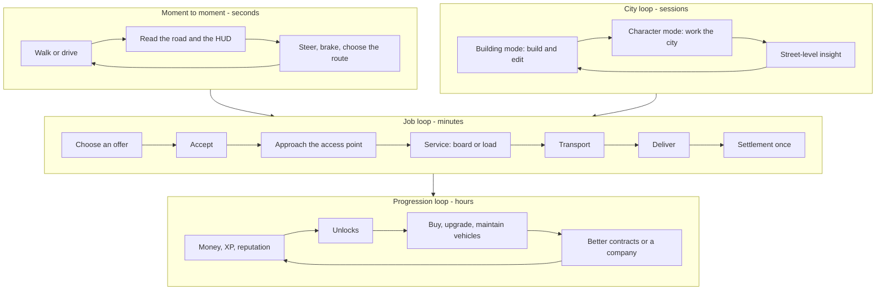

# Game Design — Drive the City II

| Field | Value |
|---|---|
| ID | DOC-GDD |
| Document status | Draft |
| Release scope | v1.0 |
| Phases | PHASE-06 – PHASE-11 (design applied); PHASE-12 (balance validation) |
| Responsible role | Coordinator (maintainer); project owner approves design direction; gameplay specifications hold the concrete rules |
| Related requirements | REQ-CAREER-001 – REQ-CAREER-006, REQ-ECON-001 – REQ-ECON-005, REQ-GARAGE-001 – REQ-GARAGE-006, REQ-COMPANY-001 – REQ-COMPANY-003, REQ-CHAL-001 – REQ-CHAL-003, REQ-ONBOARD-001 |
| Related documents | [VISION](VISION.md), [PRD](PRD.md), [PLAYER_JOURNEYS](PLAYER_JOURNEYS.md), [SPEC-MISSION](../gameplay/MISSION_FRAMEWORK.md), [SPEC-ECON](../gameplay/PROGRESSION_AND_ECONOMY.md), [SPEC-GARAGE](../gameplay/VEHICLE_OWNERSHIP_AND_GARAGE.md), [SPEC-CHALLENGE](../gameplay/CHALLENGES_AND_DYNAMIC_CITY.md), [MOTOR_TOWN_REFERENCE](../research/MOTOR_TOWN_REFERENCE.md) |
| Last updated | 2026-10-18 |

> **Status:** design intent only. Nothing is implemented, and every number in this document is an illustrative
> **[Proposal]**, not a measured or final value. Validation status of every design claim: **Not run**.

## 1. Purpose and authority

This document explains **how the game should feel and why**: core loops, original design choices, balancing
principles, the difficulty curve, and failure philosophy. It does not define requirements (the [PRD](PRD.md) does)
or exact rules and parameter tables (the gameplay specifications do). If this document and a gameplay specification
disagree on a rule, the specification wins and this document is corrected.

## 2. Design summary

The player is a newcomer driver in their own city. They start with nothing but a basic rental and an always-available
taxi shift. They learn the streets, earn a reputation, and specialize in deliveries, freight, or buses. They buy and
maintain their own vehicles and eventually run a small company whose staff are simulated on paper and labeled as such.
The city they build decides where the work is, how long it takes, and which careers are possible.

## 3. Core loops

### 3.1 Moment-to-moment loop (seconds)

- **On foot:** walk or run on sidewalks and plazas, look around, and approach a vehicle or a service point. Prompts
  appear only when an action is possible ([SPEC-PLAYER](../gameplay/PLAYER_AND_CAMERAS.md)).
- **Driving:** throttle, brake, steer, and choose a route through traffic. The driving goal is control and
  smoothness, not top speed ([SPEC-DRIVING](../gameplay/VEHICLE_DRIVING.md)).
- **Feel targets [Proposal]:** a car turns predictably at city speeds; heavier classes are noticeably slower to
  accelerate and stop; contact with buildings stops the vehicle instead of passing through it; nothing jumps after a
  frame stall (REQ-TIME-003).

### 3.2 Job loop (minutes)

The shared mission lifecycle (`Offered` → `Accepted` → `Active` with legs → `Completed` / `Cancelled` / `Failed`,
plus `Invalidated` and `Expired`) is defined in [SPEC-MISSION](../gameplay/MISSION_FRAMEWORK.md). From the player's
side:

1. **Choose:** offers show the career, destination district, route distance, an estimated pay, and constraints such as
   a deadline, fragility, or capacity.
2. **Commit:** accepting starts the job. Cancelling later is allowed, and its cost is shown before confirmation.
3. **Approach and service:** drive to a validated access point (curbside, stop, or loading bay). Boarding or loading
   is represented on screen.
4. **Transport:** follow or improve on the suggested route. Smooth, punctual driving improves the result.
5. **Settle:** one settlement summary per job, recorded once in the ledger, with experience and reputation.

**Career flavor [Proposal]** (details in each career specification):

| Career | Distinct skill | Key constraint | Specification |
|---|---|---|---|
| Taxi | Smooth, direct trips | Passenger comfort and directness | [SPEC-TAXI](../gameplay/careers/TAXI.md) |
| Urban delivery | Planning multi-stop routes | Deadlines and fragile cargo | [SPEC-DELIVERY](../gameplay/careers/DELIVERIES.md) |
| Rigid-truck freight | Handling mass in tight streets | Capacity, cargo mass, and loading bays | [SPEC-FREIGHT](../gameplay/careers/FREIGHT.md) |
| Bus | Line discipline | Stop order, capacity, and trip evaluation; career passengers only | [SPEC-BUS](../gameplay/careers/BUS.md) |

### 3.3 Progression loop (hours)

Money, experience per career, and reputation unlock vehicles, careers, and better contracts
([SPEC-ECON](../gameplay/PROGRESSION_AND_ECONOMY.md)). The main decision is **rent or own**. Renting is flexible
and always available. Owning removes rental fees, but it brings fuel, wear, and maintenance responsibility
([SPEC-GARAGE](../gameplay/VEHICLE_OWNERSHIP_AND_GARAGE.md)). The long-term goal is a small company, which adds
breadth (more contracts at once) rather than replacing the player's own driving
([SPEC-COMPANY](../gameplay/COMPANIES_AND_FLEET.md)).

### 3.4 City loop (sessions)

The player alternates between Building mode and Character mode. Building changes the work: a new bus line enables
bus shifts, an industrial district brings freight, and a bypass shortens deliveries. Working changes the player's
understanding of the city: they feel the bottleneck at the bridge or the missing curb space by the station. In v1.0
the mod only **reads** the city (REQ-CITY-001), so the city loop runs through the player's own decisions, not
through hidden writes to the simulation.

## 4. Original design choices and why

| Choice **[Proposal]** | Why | Rejected alternative | Where it is specified |
|---|---|---|---|
| Career mode uses only career vehicles (rental, owned, service) | Keeps the native simulation intact and honest; a citizen's car never becomes loot (REQ-ENTITY-002) | Taking over any vehicle on the street (kept only in sandbox mode, with handback) | [SPEC-ENTITY](../architecture/ENTITY_LIFECYCLE.md) |
| Curbside **access points** instead of doors or interiors | Works for every building asset in every city; matches how real drivers stop | Navigable interiors (expansion EXP-001) | [SPEC-CITY](../architecture/CITY_INTEGRATION.md), [SPEC-HOME](../gameplay/HOME_AND_SERVICE_POINTS.md) |
| Mod-owned career passengers and cargo | Honest, and avoids double-satisfying native demand (REQ-CITY-003) | Native citizens as passengers (EXP-002) | [SPEC-TAXI](../gameplay/careers/TAXI.md), [SPEC-BUS](../gameplay/careers/BUS.md) |
| Service points at **player-chosen** eligible buildings | The player's city may lack a "garage" building type; letting the player choose where their repair desk or garage is makes the city theirs **[Historical input]** | A required special building type | [SPEC-HOME](../gameplay/HOME_AND_SERVICE_POINTS.md) |
| A ledger visible to the player | Trust: every payout and cost is explainable, and duplication is visible (REQ-ECON-002) | A balance number only | [SPEC-ECON](../gameplay/PROGRESSION_AND_ECONOMY.md) |
| A managerial company with an explicit label | Gives long-term goals without pretending that employees drive in the city (REQ-COMPANY-002) | Physical employee fleets (EXP-003) | [SPEC-COMPANY](../gameplay/COMPANIES_AND_FLEET.md) |
| Semi-realistic, consistent handling | Fun and predictable on city streets; feasible without simulator physics (REQ-DRIVE-002) | Simulator-grade or structural physics (EXP-008) | [SPEC-DRIVING](../gameplay/VEHICLE_DRIVING.md), [ADR-0004](../architecture/decisions/ADR-0004-physics-strategy.md) |
| Stationary entry and exit, with a substitute transition if animation is unavailable | Safe placement first; avoids impossible animation dependencies (REQ-TRANS-001, REQ-ART-001) | Entering moving vehicles (EXP-022) | [SPEC-TRANSITION](../gameplay/WALK_DRIVE_TRANSITIONS.md), [SPEC-ART](../experience/ART_AND_ANIMATION.md) |
| Return to Building at any stable moment, without losing anything | City building stays first-class (pillar 5) | A separate career save or a "career-only" session | [SPEC-CONTROL](../architecture/CONTROL_AUTHORITY.md), [SPEC-TIME](../architecture/GAME_TIME_AND_PAUSE.md) |
| Recovery is a normal, explained action | Physical edge cases in a city we did not build are unavoidable; a clear "get me out" keeps play going (REQ-RECOV-001) | Requiring a reload | [SPEC-RECOVERY](../architecture/ERROR_RECOVERY.md) |

## 5. Provisional balancing principles

All values in this section are **[Proposal] — illustrative, not measured**. The authoritative parameter tables live
in [SPEC-ECON](../gameplay/PROGRESSION_AND_ECONOMY.md) and [SPEC-GARAGE](../gameplay/VEHICLE_OWNERSHIP_AND_GARAGE.md).
They are tuned with playtest evidence at M2 and M3 and validated in PHASE-12 (RISK-305).

**Principles:**

1. **Pay follows the road, not the crow.** Pay depends on route distance through the road network plus a quality
   component (smoothness, punctuality, cargo care). Straight-line distance is never used.
2. **Skill beats speed.** The quality component rewards punctual, smooth driving. Reckless speed alone never
   maximizes pay, and the punctuality bonus is capped.
3. **Bounded downside.** No single negative event (failure, cancellation, recovery, repair from one incident) costs
   more than roughly one typical job's pay.
4. **The starter path is free at the point of need.** When the wallet cannot cover a basic rental, the rental is paid
   from the next earnings instead of upfront (REQ-ECON-004). The exact mechanism is defined in SPEC-ECON and SPEC-GARAGE.
5. **Every sink has a reason.** Fuel, maintenance, rental, salaries, and fees each appear as named ledger entries.
6. **Driving stays central.** Personal driving earns more per hour than any single company vehicle. The company
   gives breadth and passive income, not a better way to play.
7. **City size should not decide viability.** Offers favor a target driving time band (about 3 to 10 minutes) so
   that small and large cities both produce playable jobs. Pay scales with distance, so long trips in large cities
   pay more.
8. **No exploit loops.** Jobs have a minimum route distance. Identical origin and destination pairs have a cooldown.
   Pausing, switching modes, and save/load never pay (REQ-TIME-004, REQ-CAREER-004). Sandbox mode never pays.

**Illustrative ratios.** We use a neutral unit, **R**: the expected pay of one typical early taxi fare (about 5
minutes of driving).

| Quantity | Illustrative target | Intent |
|---|---|---|
| Basic rental | About 1 R per rental session; deferred when the wallet is short | Paid off within the first two or three jobs |
| Fuel used by one job | At most 0.1 R | Noticeable over a session, never decisive on one job |
| Routine maintenance from normal wear | About 0.5–1 R per hour of driving | Owning has a running cost |
| Recovery service (tow or fuel delivery) | At most 1 R, deferrable | Recovery never ruins a session |
| Player cancellation after accepting | No money; a small reputation cost | Cancelling is allowed but not free |
| No-fault invalidation (city edit, removed destination) | No money and no reputation cost | The player is never punished for building |
| Failed job (for example, a missed deadline) | Reduced or no pay; a small reputation cost; never a charge above 1 R | Failure teaches without ruining |
| First owned basic car | About 25–40 R (roughly 2–3 hours of play) | The first big goal is reachable in a few sessions |
| Upgrade effect | Modest and measurable (for example, 5–15% shorter braking distance) | Upgrades are noticeable and testable (REQ-GARAGE-005) |
| First company hire break-even | Within about one long session after founding | The company feels rewarding without dominating |

## 6. Difficulty and onboarding curve

| Stage **[Proposal]** | Player learns | Gate to the next stage |
|---|---|---|
| 0. Tutorial | Walk, rent, enter, drive, first taxi fare, park, exit, save | Tutorial completed or skipped ([SPEC-ONBOARD](../experience/ONBOARDING.md)) |
| 1. Taxi driver | Reading the city, smooth driving, the wallet and ledger | A few completed fares; the economic tutorial (REQ-ECON-005) |
| 2. Courier | Multi-stop planning, deadlines, fragile cargo, a light delivery vehicle | Taxi reputation threshold; the city has commercial access points |
| 3. Freight driver | Mass, capacity, tight loading bays, a rigid truck | Delivery experience; the city has industrial or commercial loading points |
| 4. Bus driver | Line discipline, capacity, trip evaluation | Any career level threshold; the city has at least one valid bus line (OPEN-020) |
| 5. Owner and operator | Buying, maintaining, and upgrading vehicles; home base | Enough savings; garage location chosen |
| 6. Company founder | Contracts, hiring, salaries, managerial reports | An owned vehicle and a reputation threshold |

Rules for the curve **[Proposal]**:

- The taxi starter path is never locked, whatever the player's money, reputation, or vehicles.
- A career that the city cannot support is shown as unavailable **with the reason and what to build** (for example,
  "Bus shifts need a bus line with at least two reachable stops"). The minimum city content for each career is an
  open question (OPEN-301).
- Optional assists (route guidance, steering and braking assists, relaxed deadlines) are settings, not difficulty
  tiers. Relaxed deadlines extend time windows without reducing pay, because this is a single-player accessibility
  choice. The final rule belongs to SPEC-ECON.
- New careers start with a short first-job introduction (PHASE-08 gate; [SPEC-ONBOARD](../experience/ONBOARDING.md)).

## 7. How the built city shapes play

- **Where the work is:** job generation uses building types, access, transit lines, and route distances
  (REQ-CHAL-003). Residential and commercial areas feed taxi fares, commercial streets feed deliveries, industry feeds
  freight, and transit lines feed bus shifts.
- **How hard it is:** deadlines are computed from the route estimate at offer time plus slack **[Proposal]**, so a
  congested city is harder but not impossible. Steep slopes, bridges, tunnels, and narrow streets change how heavy
  vehicles behave (REQ-WORLD-001).
- **What is possible:** missing infrastructure means missing careers, explained in the UI. This invites the player
  to build.
- **What changes:** edits made in Building mode are revalidated on return. Missions are rerouted or cancelled without
  fault (REQ-CITY-002, REQ-CAREER-006).
- **Challenges:** checkpoint routes and time trials run on the player's roads (REQ-CHAL-001). Letting the player
  place their own checkpoints is a **[Proposal]** for SPEC-CHALLENGE.
- **Street-level insight [Proposal]:** a settlement summary may show read-only trip facts (for example, time spent in
  congestion) that help the player improve the city. This writes nothing to the simulation.

## 8. Feedback and rewards philosophy

- **Immediate:** prompts, HUD objective, route guidance, and audible and captioned cues for important events
  ([SPEC-UI](../experience/UI_AND_HUD.md), [SPEC-AUDIO](../experience/AUDIO.md)).
- **Per job:** one settlement summary that breaks down base pay, distance, quality, penalties, and fees, and that
  matches the ledger entry exactly.
- **Per session:** level-ups, unlocks, and reputation changes are announced once and can be reviewed later.
- **Never:** randomized paid rewards, hidden multipliers, or messages that suggest the native city was affected when
  it was not.

## 9. Failure philosophy: always recoverable

| Failure | Consequence **[Proposal]** | Way out |
|---|---|---|
| Missed deadline or damaged cargo | Reduced pay and a small reputation cost | Next offer |
| Player cancels | No pay and a small reputation cost | Next offer |
| Mission invalidated by the city or the system | No fault, no cost | New offers; reroute if possible |
| Vehicle out of fuel or immobilized | Bounded recovery cost, deferrable | Recovery service, basic rental ([JRN-008](PLAYER_JOURNEYS.md)) |
| Stuck, out of bounds, or wrong level | None | `Recovery` to the nearest validated safe point (REQ-RECOV-001) |
| No money | None beyond lost opportunity | Starter taxi job with a deferred basic rental (REQ-ECON-004) |
| Company cannot pay salaries | Contracts paused; staff released if unresolved | Personal career continues ([JRN-007](PLAYER_JOURNEYS.md)) |
| Internal mod error | Safe degradation, such as a return to `Building` | Error logged; the save is protected (REQ-RECOV-002) |

Every failure states its reason and the next step (REQ-UI-003). No failure removes the taxi starter path.

## 10. v1.0 content completion criteria

v1.0 content is complete when every row holds in any supported city that meets the minimum content (OPEN-301).
Values marked **[Proposal]** are targets for owner review. Unmarked rows restate PRD requirements.

| Area | Criterion |
|---|---|
| Careers | Taxi, urban delivery, rigid-truck freight, and bus each have reachable contracts, completion, failure, reward, and persistence (PHASE-08 gate); at least three contract variants per career **[Proposal]** |
| Vehicle classes | Car, light delivery vehicle, rigid truck, and bus with distinct handling and capacity (REQ-DRIVE-003); at least one rentable and one purchasable model per class **[Proposal]**, subject to OPEN-034 |
| Progression | Experience per career, reputation, and unlocks (REQ-ECON-003); at least one meaningful unlock per career level band **[Proposal]** |
| Garage | Rental, purchase, sale, fuel, wear, and maintenance; at least one measurable upgrade per class **[Proposal]** (REQ-GARAGE-001 – REQ-GARAGE-006) |
| Home and services | Residential base, garage location, job board, rental, repair, and fuel at exterior service points (REQ-HOME-001, REQ-HOME-002) |
| Company | Found, name, contracts, hiring, salaries, costs, and a managerial-simulation label (REQ-COMPANY-001 – REQ-COMPANY-003) |
| Challenges | Checkpoint route, time trial, parking, and precision challenges (REQ-CHAL-001, REQ-CHAL-002) |
| Onboarding | First-job tutorial, economic tutorial, and per-career introductions (REQ-ONBOARD-001, REQ-ECON-005) |
| Presentation | HUD, menus, map, English and PT-BR, gamepad, and accessibility options (REQ-UI-*, REQ-L10N-001, REQ-INPUT-*) |
| Journeys | Every journey in [PLAYER_JOURNEYS](PLAYER_JOURNEYS.md) passes its planned tests |

## 11. Design risks and open questions

| ID | Summary |
|---|---|
| RISK-023 | The core loop may not be fun at street level; judged at the M2 checkpoint. |
| RISK-019 | Economic softlock; covered by the failure philosophy above. |
| RISK-301 (new) | Career variety depends on the player's city. Small or monotonous cities may produce repetitive or unavailable careers. |
| RISK-305 (new) | Balance is built on illustrative values without play data, so it may be grindy or exploitable. |
| OPEN-301 (new) | What minimum city content does character mode and each career need? |
| OPEN-306 (new) | How should the wallet's currency be presented so it is never confused with the city budget? |
| OPEN-020 | Can transit lines and stops be read reliably (bus career availability)? |

Full entries: [RISKS_AND_OPEN_QUESTIONS](../planning/RISKS_AND_OPEN_QUESTIONS.md).

## 12. Provenance

- The loop "accept work → collect or board → transport → deliver → get paid → invest" is adapted from observable
  Motor Town gameplay, as described in [chat.md](../../chat.md) **[Historical input]** and mapped in
  [MOTOR_TOWN_REFERENCE](../research/MOTOR_TOWN_REFERENCE.md). Our systems are original. No rules, numbers, assets,
  or code are taken from Motor Town.
- Player-chosen exterior service points and a managerial company first come from the historical plan
  **[Historical input]**, confirmed by the owner brief **[Owner requirement]**.
- All other choices, ratios, and stages in this document are **[Proposal]**.
